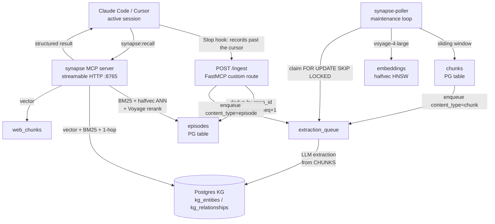
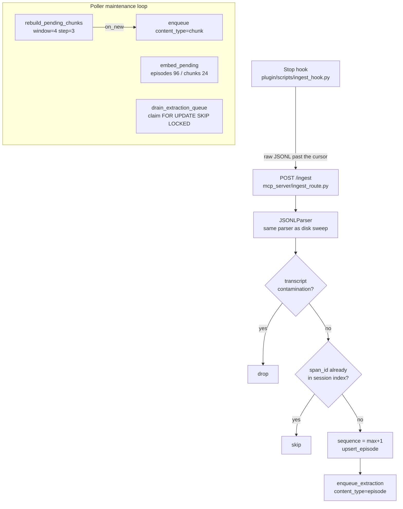
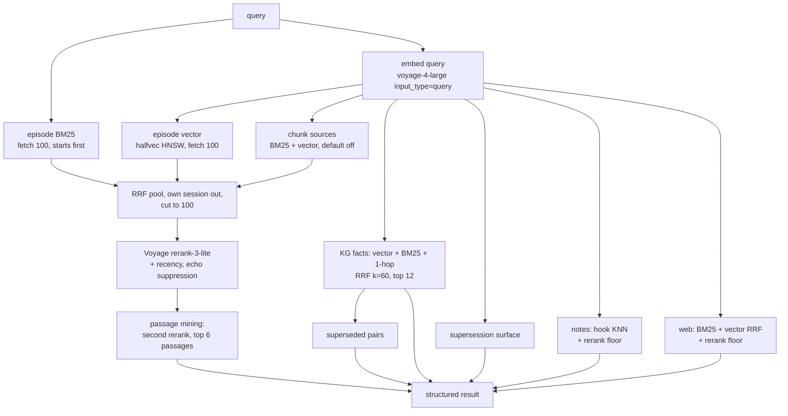

# Synapse Architecture

Synapse is a persistent episodic memory layer for AI assistants. It captures Claude Code (and Cursor) session transcripts, structures them into retrievable memory units, extracts entities and facts into a knowledge graph, and exposes everything through an MCP server that Claude Code and claude.ai call during active sessions.

**The core problem it solves**: Claude Code sessions have no memory across restarts. Every new session starts cold. Synapse bridges that gap by indexing everything that happened in past sessions and making it retrievable via hybrid search that fuses reranked episodes with knowledge-graph facts. (Recall makes two Voyage API round-trips — query-embed and cross-encoder rerank — so it is not instant: roughly 1.5s warm, rising to a few seconds on a cold first call after the server has been idle. Measured on the homelab prod instance.)

**One-paragraph mental model**: A Claude Code `Stop` hook pushes the not-yet-shipped part of each session transcript to an HTTP `/ingest` endpoint. Episodes land in Postgres, get grouped into overlapping chunks, and the chunks are the substrate the knowledge-graph extractor mines for entities and facts (written to a knowledge graph in Postgres). At recall time, the MCP server runs a reranked episode leg (BM25 + vector), a KG fact leg, a notes leg and a web-research leg in parallel (plus the bitemporal history of the facts it serves), and returns a compact structured result. There is **no Logfire polling, no summary layer, and no served chunk bucket** — all three were retired during 2026.

> **Status note (2026-06-05):** This document was reconciled against the live code after a large architectural drift. The headline changes from the previous version: (1) ingestion moved from Logfire SQL-API polling to a Stop-hook `/ingest` push; (2) KG facts are extracted from **chunks**, not summaries; (3) the **summary/synth-document layer is retired**; (4) the **chunk bucket is no longer served** by `recall()` — episodes are served via a deep-fetch + cross-encoder rerank; (5) a **web-research ingestion subsystem** was added; (6) halfvec HNSW vector indexes shipped; (7) edges are **bitemporal** (`t_created`/`t_valid`/`t_invalid`); (8) the Docker migration is done — all services run in Docker on the server host.
>
> **Status note (2026-06-24):** Reconciled again for the FalkorDB→Postgres KG cutover and the public-release plumbing. (1) the **knowledge graph moved into Postgres** (`kg_entities`/`kg_relationships`), FalkorDB decommissioned (#67) — §10 rewritten; (2) the **communities bucket was retired** with that cutover; (3) the MCP server runs **standalone `fastmcp` 3.4.2 with MultiAuth** (machine bearer + GitHub OAuth), which replaced the hand-rolled OAuth proxy (#166); (4) skills are **hosted in Postgres and served as `skill://` resources** with two-way sync (§7.6); (5) **26 migrations** (was 16); (6) a Claude Code **plugin + marketplace** is the distribution path.

---

## Table of Contents

1. [System Overview](#1-system-overview)
2. [Tech Stack](#2-tech-stack)
3. [Document Types](#3-document-types)
4. [Ingestion Pipeline](#4-ingestion-pipeline)
5. [Knowledge Graph Extraction](#5-knowledge-graph-extraction)
6. [Recall Pipeline](#6-recall-pipeline)
7. [MCP Server](#7-mcp-server)
8. [Web Research Subsystem](#8-web-research-subsystem)
9. [Database Schema](#9-database-schema)
10. [Postgres Graph Model](#10-postgres-graph-model)
11. [Nightly Maintenance & Dream Pipeline](#11-nightly-maintenance--dream-pipeline)
12. [Key Design Decisions](#12-key-design-decisions)
13. [Configuration](#13-configuration)
14. [File Structure](#14-file-structure)
15. [Operational Notes](#15-operational-notes)
16. [Known Gaps & Planned Work](#16-known-gaps--planned-work)

---

## 1. System Overview



**Data flow summary**:

1. A Claude Code `Stop` hook (`plugin/scripts/ingest_hook.py`; Codex has its own, `plugin-codex/hooks/synapse_stop_hook.py`) fires on every turn and POSTs the part of the raw session JSONL past a durable per-file cursor to `http://<server-host>:8765/ingest`. It runs detached and never blocks the turn. (Any other agent frontend that drives the real `claude` CLI ingests the same way.)
2. `/ingest` parses the tail, drops transcript contamination, **dedups by `span_id`**, and appends genuinely-new turns as episodes at `max(sequence)+1`, enqueuing each for KG extraction.
3. The **poller** (a maintenance loop, *not* an ingester) rebuilds sliding-window chunks, embeds pending episodes/chunks via Voyage AI, and drains the extraction queue.
4. KG extraction runs on **chunks** (3–5 turn windows): Haiku extracts entities + facts, resolves entities against the Postgres KG, dedups/contradicts against existing facts, and writes bitemporal relationship edges (`kg_relationships`).
5. When a new session calls `synapse:recall`, the MCP server runs its legs in parallel (episodes, KG facts, notes, web, with the bitemporal history of the served facts) and returns a compact ranked result.

**Where things run**: All Synapse services (poller, MCP server, dream) run in Docker on the **server host** alongside Postgres. Claude Code runs on the **client machine** and reaches the MCP server over the network at `http://<server-host>:8765/mcp` with a machine **bearer token**. The hosted claude.ai connector reaches the same server at a public hostname (e.g. `synapse.example.net`, via a Cloudflare tunnel) and authenticates via **GitHub OAuth** — handled by the server's own `fastmcp` **MultiAuth**, which replaced the former hand-rolled OAuth proxy (#166). Prod compose + `.env` live at a dedicated deploy path on the server host (e.g. `/opt/synapse`).

---

## 2. Tech Stack

| Component | Technology | Notes |
|-----------|------------|-------|
| Language | Python 3.12 | |
| Package manager | uv | `uv run` everywhere, no pip/venv activation |
| Relational store | PostgreSQL + ParadeDB image (server host :5432) | |
| Vector search | pgvector, `vector(2048)` columns + **halfvec(2048) HNSW** | HNSW shipped (#104); `embedding::halfvec(2048)` because pgvector HNSW caps plain `vector` at 2000 dims |
| Full-text search | ParadeDB `pg_search` (BM25) | `id @@@ paradedb.match('content', …)` |
| Graph store | PostgreSQL (`kg_entities`, `kg_relationships`) | FalkorDB **decommissioned** (#67) — the KG is Postgres-only (`ingestion.kg_client`, recall via `mcp_server.kg_pg`); bitemporal edges via `t_valid` / `t_invalid` |
| Embeddings | Voyage AI `voyage-4-large`, 2048 dims | separate `input_type` for query vs document |
| Reranker | Voyage `rerank-3-lite` cross-encoder (default since 2026-10-02; WIN1 measured on `rerank-2.5`) | the active ingredient in episode recall (WIN1) |
| LLM calls | `claude-agent-sdk` via `ClaudeCLIClient` / `agent_call` | `claude-haiku-4-5`; subscription OAuth token or `ANTHROPIC_API_KEY` (or an OpenAI-compatible endpoint via `SYNAPSE_LLM_PROVIDER=openai`) |
| MCP server | **standalone `fastmcp` 3.4.2**, HTTP (stateless), port 8765 | `/mcp` (tools + `skill://` resources), `/ingest` + `/recall` custom routes; **MultiAuth** (machine bearer + GitHub OAuth) |
| Ingestion trigger | Claude Code `Stop` hook → HTTP push | **replaced Logfire polling** (now removed) |
| Data models | Pydantic v2 | |
| Postgres driver | psycopg3 (`dict_row`); the server borrows from one shared pool (`ingestion/pg_pool`) | |
| JSON | orjson | |
| Telemetry | Logfire **emit only** | all Logfire *read/poll* paths removed (#108); spans still emitted to the configured Logfire project |
| Auth | `fastmcp` MultiAuth: `StaticTokenVerifier` (bearer) + `GitHubProvider` OAuth | machines send one bearer on every endpoint; claude.ai does GitHub OAuth on `/mcp`; **replaced the hand-rolled OAuth proxy** (#166) |
| Skills serving | machine-token `/skills/*` HTTP routes (DSN-free, two-way) + `PgSkillsProvider` `skill://` resources | skills hosted in Postgres (`skills_lane.skill_registry.body` + `skill_files`), materialized to `~/.claude/skills`; per-skill hash + `content_modified_at` reconcile, append-only `skill_history` |
| Distribution | the server serves its own client (`GET /install`) + Claude Code plugin via `.claude-plugin/marketplace.json` | `curl <server>/install \| python3 -` then `synapse login`: one approval enrolls the machine, settings live in `~/.synapse/config.json`, and login wires the Claude plugin and Codex hooks itself |

### The LLM call path (`claude-agent-sdk`)

Extraction does **not** shell out to `claude --print`. Despite the legacy class name `ClaudeCLIClient`, all LLM calls go through `claude-agent-sdk`'s `ClaudeSDKClient` + `ClaudeAgentOptions` (`ingestion/llm_client.py`). Two shapes over the same SDK:

- `ClaudeCLIClient.messages.create(...)` — a synchronous, `anthropic.Anthropic()`-shaped interface (what the extractor/dedup/contradiction/edge-date call sites use). Wrapped in tenacity retry; bridges to async via `asyncio.run`.
- `agent_call` / `agent_call_batch` — native async, used where concurrency matters.

```python
opts = ClaudeAgentOptions(
    allowed_tools=[],
    max_turns=max_turns,
    model=model,                       # "claude-haiku-4-5"
    cli_path=_CLI_PATH,
    output_format=output_format,
    max_thinking_tokens=_MAX_THINKING_TOKENS,   # 2048 (#121)
)
async with ClaudeSDKClient(options=opts) as client:
    await client.query(full_prompt)
    async for msg in client.receive_response():
        ...
```

Auth is a Claude subscription OAuth token (`CLAUDE_CODE_OAUTH_TOKEN`) or an `ANTHROPIC_API_KEY`, consumed by the spawned `claude` CLI rather than by Synapse itself. Scripting a subscription OAuth token against the raw Anthropic API is ToS-prohibited; the SDK/CLI subprocess is the sanctioned path. Extraction is Haiku-only — ~10x cheaper than Sonnet and sufficient for short structured classification.

---

## 3. Document Types

Synapse keeps three **live** document substrates plus the KG. Episodes are the served retrieval workhorse; chunks are the KG extraction substrate; web chunks are the web-research substrate. The summary/dream layer is **retired**.

### 3.1 Episodes — the served workhorse

**One episode per user-initiated exchange.** Each captures a single human turn: a short orientation prefix (the prior assistant response), the new user message, all tool calls and results, and the final assistant response.

```
[context] truncated previous assistant response — orientation anchor
[user]    the human message text
[tool:Bash] command string
[result] tool output
[assistant] final response text
```

**Why human-turn granularity, not per-API-call**: Claude Code makes 3–8 API calls per user turn (each tool result requires re-submission). A 1:1 span→episode mapping produces ~63% assistant-only fragments with no human context and weak embeddings. Grouping by the human-message boundary gives coherent units. Episodes are served directly by `recall()` (BM25 + vector, reranked) — they own both broad and needle retrieval.

**Stored in**: `episodes`. Key columns: `session_id`, `sequence`, `project`, `platform`, `content`, `embedding vector(2048)`, `human_turn`, `assistant_turn`, `span_id` (dedup key), `retrieval_count`, `source`.

### 3.2 Chunks — the KG extraction substrate

**Sliding window of 4 consecutive episodes, step 3 (1-episode overlap).** Only complete windows are written, so a chunk is created once and never superseded.

**Role**: Chunks are **not served by `recall()`**. They exist solely as the substrate the KG extractor mines for facts — a 4-episode window carries enough context (question → attempts → errors → resolution) to extract quality entities and relationships, where a single thin turn ("ok, continue") does not. Measured ~2.66 quality-weighted facts/episode from chunks vs much lower from episode-level or summary-level extraction (#63).

**Stored in**: `chunks`. Key columns: `session_id`, `start_sequence`, `end_sequence`, `episode_ids JSONB`, `content` (episodes joined by `---`), `embedding vector(2048)`. Idempotent on `(session_id, start_sequence, end_sequence)`.

### 3.3 Web artifacts & web chunks — the web-research substrate

Web-research tool results (WebFetch, Exa, Firecrawl, WebSearch) are captured as first-class rows so past research is recallable. A `web_artifacts` row is the captured page/search/job; `web_chunks` are its embedded slices (with an optional contextual-retrieval prefix). The `web` bucket in `recall()` is served from `web_chunks`. See [§8](#8-web-research-subsystem).

### 3.4 Knowledge graph (Postgres)

`kg_entities` rows and bitemporal `kg_relationships` fact edges (migrated out of FalkorDB in #67). The KG is the relational/multi-hop specialist served as a side bucket (`facts`), never the primary retrieval path. See [§10](#10-postgres-graph-model).

### 3.5 Timeline events — the episodic date log

`timeline_events` (schema 033) is the EPISODIC complement to the semantic KG: an append-only, time-ordered log of dated **point-events that happened** ("shipped X", "decided Y", "fixed Z"), distinct from the KG's deduplicated states-with-duration. Two feeders:

- **Chat gate** (`ingestion/timeline_gate.py`): one small LLM call per ingested turn asking "did something actually HAPPEN?" — most turns are discussion and emit nothing. Emitted events are naked past-tense facts (no actor field; the verb carries decides-vs-executes), self-contained, dated to the turn with validated resolution of "last Tuesday"-style mentions.
- **Git feeder** (plugin `git_feeder.py`): commits pushed as `source='git:<project>'` events, author-dated.

Idempotency rides on `UNIQUE(source, source_ref)`. Three write-time quality mechanisms (all default-on, individually kill-switchable):

- **Confirm-merge dedup** (schema 037): a re-told happening (same real-world event narrated again later, often with a differently-resolved date) merges into its existing row instead of inserting — nearest same-project candidates within ±14d / cosine < 0.20 go to an LLM confirm that reads **both full source turns** and must answer SAME in **both presentation orders**. Non-destructive: `reported_count += 1`, `t_valid = LEAST(...)`, no deletes. Measured before shipping: snippet-only judging is unreliable (79% on 120 stratified pairs — the discriminating info lives in the source turns); the shipped form leaves ~2% residual false-merge, all recoverable. Distance alone cannot be the merge key in either direction (recurring chores sit at d≈0.02; date-split retellings sit further out).
- **Domain scoping** (schema 038): the gate labels each event `personal` (the user's own life) or `technical` (engineering/work); git events are technical by construction; NULL = unlabeled and fails open. An explicit `group_id="personal"` on the read side filters the timeline to life events. Measured motivation: for a reworded personal query, cross-domain junk sat *closer* in embedding space (0.704) than the true personal events (0.748+), so no relevance floor can do this job — only a domain label can. The default/technical scope stays unfiltered so callers that never set `group_id` lose nothing. With `SYNAPSE_PERSONAL_SCOPE=0` the gate is never asked for a domain and every event is stored `technical`.
- **Quoted-material suppression**: happenings narrated inside pasted third-party content (someone else's email, a meeting/interview/legal transcript, an article with first-person narration) are never emitted as the user's events — the gate distinguishes content the user *asserted* from content the user *quoted*. The user's own work on the material, and third-party statements *about* the user, stay eligible. Probed on labeled cases before shipping: third-party leaks 2/8 → 0/8 with no legit-event loss.

**Serving**: `recall()` does not retrieve timeline events and there is no `recall_timeline` tool (both removed 2026-08-07: 39 helpful against 92 noise citations lifetime; the store, its gate and the board block stayed). The events are read by the board's **Last 7 days** block (`GET /context`; `timeline_routes._recent_events`, a pure time-window read of the newest salient events under a per-project-day cap, a day being the user's local day, each line carrying its `t:N` id) and by the dashboard's Timeline page and search.

### 3.6 Retired: summaries & dream documents

`synth_documents` (`doc_type='summary'|'dream'`) is a **frozen legacy table** (~669 stale rows). Nothing generates new rows, `recall()` never serves them, and they are no longer the KG extraction substrate. Residual scaffolding remains (an embedding leg in the poller that finds nothing, `summary` branches in the extractor) pending a snapshot + purge. Treat the summary layer as **dead**; the episode leg and KG facts absorbed both its broad-recall and relational jobs.

---

## 4. Ingestion Pipeline

Episodes enter Synapse through `/ingest`: a `Stop` hook (Claude Code's or Codex's) POSTs the transcript records it has not shipped yet. **There is no Logfire polling** — `ingestion/logfire_client.py` no longer exists, and Logfire is used only to *emit* telemetry.



### 4.1 The `/ingest` endpoint

A Starlette custom route on the FastMCP server: `@mcp.custom_route("/ingest", methods=["POST"])`. The Stop hook posts `{"records": [...], "source": "hook", "project": "<label>"}`; the body is parsed with the same `JSONLParser` the disk-sweep backstop uses. The dedup loop:

```python
for ep in episodes:
    if is_transcript_contamination(ep.content):    # reject known PII-bearing payloads
        dropped += 1; continue
    if ep.session_id not in index:
        index[ep.session_id] = db.get_session_span_index(ep.session_id)   # (seen span_ids, max_seq)
    seen, max_seq = index[ep.session_id]
    if not ep.span_id or ep.span_id in seen:
        continue                                   # no identity, or already stored — skip
    max_seq += 1
    ep.sequence = max_seq                          # the tail's positional seq is discarded
    seen.add(ep.span_id)
    eid = db.upsert_episode(ep)
    if ep.content and ep.content.strip():
        db.enqueue_extraction(ExtractionItem(episode_id=eid, session_id=ep.session_id,
                                             content=ep.content, content_type="episode", project=ep.project))
```

- **Dedup by `span_id`** — a turn's stable last-record UUID. The session's `(seen span_ids, max_seq)` index is loaded once per session. The tail's own positional sequence is discarded (a tail renumbers from 1 and would collide).
- **Cross-session content guard** (schema 036, `SYNAPSE_CONTENT_DEDUP=0` to disable) — the span guard is per-session, so a retry session or re-import that replays a turn under a *fresh* session/span id sails through it. A second check skips any turn whose content is byte-identical (`md5(content)` index) to an episode already stored in the same project, or stored from the same working directory under any label (so a replay whose first copy carries an older label for that folder, before `scripts/relabel_projects.py` merges them, is still caught). Measured on a real corpus: ~4.6% of episodes were exact replays (agent re-runs, mid-session forks, re-imports) before this guard.
- **Append at `max(seq)+1`** — new turns extend the session.
- **Contamination filter** — `is_transcript_contamination` drops PII-bearing third-party transcript payloads (produced by another agent project sharing the same hooks).
- **Private-mode filter** (schema 050) — `PrivateSessions.is_private` drops every turn whose `session_id` sits in `private_sessions`. Same chokepoint, same shape as the contamination predicate, and `ingestion/backfill.py` applies it too, so a session taken off the record can't be ingested by a path that bypasses the hook (catch-up sweep, disk backfill, a re-import months later). Rows are permanent by design: the transcript survives on disk, so deleting the row would re-expose exactly the turns the user hid.
- Runs in a threadpool so the async route never blocks.


**Project labels.** Every client labels a session's project with one resolver,
`plugin/scripts/synapse_project.py` (the Codex plugin loads the same file): a
`.synapse-project` marker file (its first non-comment line; searched from the working
directory up to the git toplevel, and in a linked worktree also at the main checkout's
root), else the git toplevel's name (a linked worktree, including Claude Code's
`.claude/worktrees/<id>`, is its main checkout; a bare repository's worktree is the
repository's name), else the folder's name. Both separators, case kept. The ingest hooks
send it as `"project"`, the board asks for that project, and the skills sync syncs
`project:<label>`, so a session started in a subfolder or a worktree is filed, shown and
served as its repository. A body without a label (a catch-up of a transcript whose folder
is gone, an older plugin) is labelled server-side from the transcript's `cwd` by
`ingestion/project_label.py`: the last component of the path, either separator. A restricted
device's allowlist matches labels case-insensitively (`resolve_caller` widens it to every
stored casing of its entries). `scripts/relabel_projects.py` maps labels stored before this
onto canonical names (`--dry-run` first; the alias file stays outside the repository).

### 4.2 The Stop hook

`plugin/scripts/ingest_hook.py` fires on every turn; the Codex analog, `plugin-codex/hooks/synapse_stop_hook.py`, shares its retry bookkeeping (`synapse_ingest_retry.py`). It ships the transcript records past a **durable per-file cursor** (`DATA_DIR/ingest_cursors.json`): the byte offset of the start of the last shipped turn, never EOF, because Claude Code may write a turn's final message after Stop fires, so the last turn is re-shipped once. The cursor advances only after a successful POST, so a failed POST self-heals: the next Stop hook, or the SessionStart `--catchup` sweep, re-ships from the same offset and the server skips every turn it already stores (a cursor past EOF means the file was truncated and resets to 0). The POST runs detached (`start_new_session=True`) and the hook always exits 0 — **it never blocks or fails a turn**.

The catch-up sweep ships any transcript modified within the catch-up window (3 days) whose cursor lags its size, plus every file whose last upload failed (marked `pending` in the cursor file) however old, so an outage longer than the window loses nothing; history from before the plugin was installed is `synapse-import`'s job. After repeated failures the SessionStart parent prints one "uploads have been failing since …" line. Enqueue-gating on new `(session, span_id)` fixed an earlier O(turns²) re-extraction loop (#61, #105, #106).

**Private mode** short-circuits the hook before any POST: `private_mode.py on <session_id>` writes a marker file at `~/.synapse/private/<session_id>`, and `_ship` skips the whole transcript while that marker is live — on the Stop path and the catch-up sweep alike. Markers expire after 12h (ignored *and* deleted) and are removed by a `SessionEnd` hook, because a session id is never reused and an orphaned marker would otherwise be permanent. The check is fail-safe in one direction: a marker directory that exists but can't be read counts as private, since silently capturing a session the user believes is off the record is the unacceptable failure and a deferred turn is not (the cursor doesn't advance). The marker is only the fast local half — the durable half is the `private_sessions` row the same CLI writes over `PUT /private-sessions/{session_id}`, which is what §4.1 enforces.

### 4.3 Chunk construction

Lives in `ingestion/chunks.py`. `_CHUNK_WINDOW = 4`, `_CHUNK_STEP = 3` → 1-episode overlap. Only complete windows are emitted (`range(0, n - window + 1, step)`); partial trailing windows wait until full. When the poller rebuilds chunks, an `on_new` callback enqueues each genuinely-new chunk for extraction with `content_type="chunk"` — exactly once, at birth. Idempotent via `ON CONFLICT (session_id, start_sequence, end_sequence) DO NOTHING`.

### 4.4 Extraction-queue enqueue gating

`enqueue_extraction` is the idempotency backstop, with branches keyed by item shape (all checking only `status IN ('pending','processing')`):
- **episode/manual** (have `episode_id`) — dedup by `episode_id`.
- **chunk** — dedup by exact `(session_id, content)` (not `(session_id, content_type)`, which would collapse every chunk of a session into one row).
- **summary/manual session-keyed** — dedup by `(session_id, content_type)`.

### 4.5 Poller maintenance loop

The poller (`ingestion/poller.py`) owns **post-ingest work only** — it does not ingest episodes. Each cycle:

1. `rebuild_pending_chunks()` — only for sessions whose episodes outgrew their chunks (cheap pre-filter).
2. `embed_pending()` — unembedded episodes (batch 96), chunks (batch 24), and any synth_docs (batch 24, normally empty).
3. `drain_extraction_queue(batch_limit=8)` — claim and process queue items.
4. Periodic `release_stale_claims()` sweep.

It uses **adaptive sleep** (3s when backlog is likely, 60s otherwise), defers the full chunk/embed cycle when the extraction backlog is large, and backs off exponentially on `UsageLimitError` (quota). `SYNAPSE_DRAIN_ONLY=1` turns a replica into a pure extraction worker.

### 4.6 Horizontal scaling: atomic claim

Multiple poller replicas claim distinct queue slices atomically (#37):

```sql
UPDATE extraction_queue
SET status = 'processing', claimed_at = now()
WHERE id IN (
    SELECT id FROM extraction_queue
    WHERE status = 'pending'
    ORDER BY priority ASC, enqueued_at ASC     -- priority lane (#015): new ingest 0 before backfill 10
    LIMIT %s
    FOR UPDATE SKIP LOCKED
)
RETURNING *;
```

`priority` (schema 015) keeps a bulk backfill (priority 10) from starving fresh turns (priority 0). `claimed_at` (schema 016) lets `release_stale_claims(older_than=45min)` recover crashed-worker orphans without clobbering a live peer mid-batch.

### 4.7 Embedding

Voyage `voyage-4-large`, 2048 dims. `input_type="query"` at recall time, `"document"` for all ingestion content. Token-aware batching packs requests under Voyage's 120K-token cap (target 100K, max 1000 items, 24K-char per-item cap). Per-doc-type poller batch sizes: episodes 96, chunks 24 (~4x longer), synth_docs 24.

---

## 5. Knowledge Graph Extraction

KG facts are extracted from **chunks**, not summaries. `ExtractionPipeline.process_item()` orchestrates per queue item; the heavy per-fact stages are **batched into one LLM/SQL call each** across all of an item's facts.

```mermaid
flowchart TD
    Q[extraction_queue\nclaimed item] --> CT{content_type?}
    CT -- episode --> S2E[Stage 2 deterministic only\n→ 0 facts → early return]
    CT -- chunk --> S2[Stage 2: DeterministicExtractor\nregex: files, URLs, errors, tools]
    CT -- summary/manual --> S2

    S2 --> S3[Stage 3: LLMExtractor\nHaiku: entities + facts JSON\nCombinedExtraction cross-ref valide]
    S3 --> S4[Stage 4: EntityResolver\nnormalized-name → LSH → vector → batched LLM confirm]
    S4 --> S5[Stage 5: write_nodes\nupsert kg_entities pgvector]

    S3 --> S6A[Stage 6a: embedding_filter\nfact ANN + pair check, no LLM]
    S6A --> S6B[Stage 6b: BATCHED LLM confirm\nduplicate / contradict / none]
    S6B --> S7[Stage 7: write_edges]
    S7 --> ED[EdgeDateExtractor batch\nt_valid/t_invalid]
    S7 --> CD[ContradictionDetector batch]
    S7 --> WR[batched INSERT + UPDATE\nbitemporal kg_relationships]
```



### 5.1 content_type gating

```python
if content_type == "episode":
    det_entities = self._stage2_deterministic(...)        # deterministic only
    llm_result = ExtractionResult(entities=[], facts=[])  # NO LLM → 0 facts → early return
elif content_type == "chunk":
    det_entities = self._stage2_deterministic([{"content": content, "metadata": {}}])
    llm_result = self._stage3_llm(content, det_entities)  # full extraction on the window
else:  # summary or manual
    episodes_raw = self._db.get_session_episodes(session_id) if session_id else []
    det_entities = self._stage2_deterministic(episodes_raw)
    llm_result = self._stage3_llm(content, det_entities)
```

**Chunks are the live fact source.** Episodes get deterministic-only extraction, which produces zero facts and returns early (the old "LLM extraction only on summaries" rule is dead). The `summary`/`manual` branch remains for back-compat and the `remember()` tool, but no summaries are enqueued anymore.

### 5.2 Stages

- **Stage 2 — `DeterministicExtractor`**: regex/metadata extraction of `File` / `URL` / `Issue` / `Tool` entities. No LLM.
- **Stage 3 — `LLMExtractor`**: one Haiku call → residual entities + facts, validated through a `CombinedExtraction` Pydantic cross-ref validator that drops facts referencing undeclared entities.
- **Stage 4 — `EntityResolver`**: resolve each entity to an existing node or mint a UUID. Strategy ladder: exact `normalized_name` → entropy gate → MinHash/LSH → **batched** Haiku "same entity?" confirm. See [§5.3](#53-entity-resolution).
- **Stage 5 — write nodes**: upsert kept (non-orphan) entities into `kg_entities` with pgvector embeddings.
- **Same-batch twins** (`ingestion/extraction_twins.py`, 2026-10-09): before Stage 6, a fact the batch states twice is written once. Stage 6 only compares against edges already in the graph, and nearly every twin is one sentence fanned out over each entity it names, so it links a different entity pair. Twins need an identical identifier signature (every token with a digit, path, URL, identifier shape, capital letter, or negation), content words that differ on at most one side (a reorder or added detail, never a substitution), and cosine >= 0.90. Cosine alone cannot do this: about 19 in 20 non-identical within-batch pairs at >= 0.95 differ in a number or a name. The most specific twin survives, and is user-attributed if any twin was.
- **Stage 6a — embedding filter**: no-LLM candidate find. A `pair_pool` (edges sharing the new fact's exact source+target) + a `semantic_pool` (RRF of vector + BM25 over fact text). `_SEMANTIC_POOL_LIMIT = 8` (#121, down from 20 — the rank 9–20 tail was noise and pushed the dedup prompt to ~30K tokens).
- **Stage 6b — batched LLM confirm**: ONE Haiku call classifies every fact-with-candidates as `duplicate` / `contradict` / `none`.
- **Stage 7 — write edges**: three batched helpers — `EdgeDateExtractor.extract_batch` (one call for all `(valid_at, invalid_at)`), `ContradictionDetector.detect_contradictions_batch` (one call for same-pair live-edge contradictions), then `invalidate_edges_batch` + `create_edges_batch` (one batched SQL statement each). Every edge a new fact retires — from the Stage-6b verdict or the writer-side detector — is linked to its successor (`invalidated_by`, schema 028): the new edge, or the confirmed existing duplicate when the write is skipped (a drop-in replacement). Until 2026-10 Stage-6b verdicts were written with no link, so a correction found at extraction was invisible to recall's successor legs. Retirement is dated by the correcting fact's evidenced valid-from (in-text date, else the conversation timestamp), clamped by the writer to no earlier than the old edge's own `t_valid`; never the write clock.

Batched stages (one call across the item's facts): Stage-4 confirm, 6b, EdgeDateExtractor, ContradictionDetector, Stage-7 writes/invalidations (#38, #40, #42, PR #83/#94). Per-item single passes: 2, 3, 5, 6a.

### 5.3 Entity resolution

**Write-path** (`EntityResolver`): pgvector returns cosine *distance* → `similarity = 1 - distance`. `< 0.85` → new node; `≥ 0.95` → trust the embedding, skip the LLM; `0.85–0.95` → batched Haiku confirm. On any error, every pending entity becomes a **new** node — a spurious duplicate is cheap, a wrong merge corrupts the graph.

**Semantic identity merge** (#48) handles lexically-*different* same-entities. Three lanes: exact-name (auto), moderate (cosine ≥ 0.95 **and** Levenshtein ratio ≤ 0.30 → Haiku confirm), and semantic (embedding-only, no name gate — the only lane that can reach `User` ≡ the user's real name). Winner is deterministic (most edges → oldest → lowest uuid); merge re-creates every edge with the full bitemporal quad.

> **Open gap (#49):** the semantic lane is **detection-only — it never auto-merges**. Hub-touching pairs (degree ≥ 50) are surfaced for human review because a wrong hub merge is irreversible. So identity hubs still re-fragment: `User` / the user's first name / the user's full name / `The User` persist as separate nodes (~2065 edges across 6 nodes). External research independently names entity resolution *the* hard problem of KG memory — this is the load-bearing fix to keep cheap. See [§16](#16-known-gaps--planned-work).

### 5.4 Bitemporal edges

`kg_relationships` edges are bitemporal (#47). The canonical quad — written alongside legacy single-field mirrors for backward-compatible readers:

- `t_created` (== `created_at`) — write time, never updated.
- `t_valid` (== `valid_at`) — when the fact began being true; from `EdgeDateExtractor` or `now()`.
- `t_invalid` (== `invalid_at`) — when the fact was superseded by a later fact; **always NULL on create**, set only by Stage-6b / writer-side contradiction. The `EdgeDateExtractor`'s `invalid_at` is no longer applied at birth (2026-10-09): a fact recording a dated happening or a bounded past state ("the outage ran Aug–Sep", "User told the assistant on 08-29 to stop X") is a true statement for good, and writing it already-retired dropped it out of the live index with no successor link (616 such edges in prod). Currency for the reader rides `t_valid` and the 058 fields.
- `t_expired` — reserved for future selective forgetting; nothing writes it yet.

Contradictions **invalidate the old edge** (an `UPDATE` setting `invalid_at`/`t_invalid`) and always write the new one — they never block it. All live-edge read filters use `t_invalid IS NULL`. This gives a queryable history of fact evolution (surfaced by recall's `history` leg).

**Evidence currency (schema 058).** `t_valid` says when a fact *became* true; nothing said when it was last *confirmed*, so a habit extracted once stayed a live present-tense fact until someone contradicted it. Three columns fix the bookkeeping without rewriting any fact text (the pipeline never invents end dates — `extract_edge_dates` forbids it): `ongoing` (the extractor's call: the fact asserts an activity, usage, or state that can lapse silently — a habit, a tool in use, a job — as opposed to a dated happening, a permanent trait, or a *description of an artifact*: "the profile lists rock climbing" is about the profile), `last_supported_at` (the conversation time of the most recent USER-attributed statement asserting the proposition; set on create and moved forward on reinforcement only when the extractor attributes the restating fact to the user and the chunk is new provenance — assistant repeats and replayed chunks never refresh it) and `last_supported_by` (that statement's episode). The extractor emits `ongoing` and `attribution` (`user` / `assistant` / `third_party`) per fact; a missing or unrecognised attribution is `unknown` and never counts as support. NULL on every pre-058 edge: unknown, not false. Recall serves `ongoing` and `supported` beside `date` ([§6.1](#61-return-shape)).

`EdgeDateExtractor` (#46) skips the LLM for any fact with no date signal via a `_TEMPORAL_RE` regex prefilter (years, ISO/slash dates, month/weekday names, "yesterday/since/until", durations, "started/stopped/no longer/used to", …) — a non-temporal fact resolves to the `now()` fallback identically, so the call is wasted.

---

## 6. Recall Pipeline

`recall()` fans out over a persistent leg executor (8 workers). Every leg borrows its own connection from the shared `ingestion/pg_pool` pool or makes its own Voyage call, so concurrent psycopg use is safe. The BM25 episode leg starts first so its fetch overlaps the query-embedding call; the embedding then releases the vector episode leg, the KG facts leg, the supersession surface, the notes leg and the web leg, all concurrently. The cross-encoder rerank starts the moment the episode pool is joined and runs while the other legs and the fact bookkeeping are still in flight. Returns a **compact, conditionally-populated** result. Interactive recall builds its Voyage clients with `interactive=True`: any retryable error, a 429 included, gets short backoffs and is given up on within about 5 s, so recall falls back to BM25-only legs and RRF order (each with a `warnings` entry) instead of hanging; the poller and dream keep the 3-minute patience.



### 6.1 Return shape

```python
out = {"query": query, "facts": facts}   # always present (facts may be []); each {fact, id, date, ongoing?, supported?}
if ep_items:        out["episodes"] = [...]   # reranked passages, one item per parent episode, cap 6 passages (see role note)
if note_items:      out["notes"]    = [...]   # {id, hook, note, project?}, cap 3
if web_chunks:      out["web"]      = [...]   # {id, context|excerpt, url?, title?, date?}, cap 3
if superseded:      out["superseded_facts"] = [...]  # {fact: old, superseded_by: current}, cap 2: the displaced version of each served fact
if warnings:        out["warnings"] = [...]   # a leg degraded; absent on a healthy call
return out
```

Every served item carries an `id` that `recall_feedback` takes: `e:N` episode, `n:N` note, `f:N` fact, `w:N` web. Facts are served as `f:<kg_relationships.id>` (a bigint, the same id the KG tables key on), and `superseded_facts` entries use the same form; the older `f:<uuid>` form is still accepted everywhere ids are parsed, so feedback on a pre-change serve keeps resolving. Only `e:` and `n:` ids are `fetch()`-able. The retired buckets (`entities`, `timeline`, `chunks`, `summaries`, `communities`) are not returned.

Served episode passages carry a **`role` provenance label** (`"user"` / `"assistant"` / `"mixed"`): episode content is assembled from role-marked parts, but passage compaction slices it into chunks and a mid-block chunk loses its marker — without the label, a reader cannot tell a human-stated fact from the agent's own past output (which may be speculation). The label is recovered deterministically from chunk char-offsets against the parent turn's marker layout; unattributable slices omit the key (fail-open, advisory only). Rank-side provenance *weighting* was deliberately rejected: serve-time rerank score surgery is the historically dead lever here, and most technical needle answers live in assistant halves — a blanket penalty would trade one failure class for a worse one.

Served facts carry `date` = `t_valid` (when the fact became true *as stored*: an in-text date, else the conversation it came from — not the last time anyone confirmed it), `ongoing: true` when the edge is flagged as a claim that can lapse silently, and `supported` = the date the user themself last asserted it (absent = never user-confirmed, or pre-058). Both dates are the user's local day (`SYNAPSE_TIMEZONE`); a value at exactly 00:00:00 UTC is a date-only value and keeps its own date. The reader contract that rides the server instructions and the `recall` description: a fact supports exactly what it states — one mention is not frequency, identity, or current activity; a fact about a profile or document describes the document; an ongoing fact with no recent `supported` is a lead to ask about, not current truth; anything written in the user's voice uses only what they said. `tests/fixtures/reader_contract.json` holds synthetic cases (licensed vs forbidden readings) that double as an eval set.

`recall_metrics.served_ids` records which ids were served per bucket (`{"episodes": ["e:12"], "facts": ["f:41"], "notes": [...], "web": [...]}`, plus `trust`, the echo, duplicate-passage and `n_chunks_cut` counters, and the abstention markers of §6.2); rows written before facts moved to `f:<bigint>` hold the raw edge uuids. `est_tokens` counts everything served including notes, never `warnings`.

### 6.2 Episode leg (the workhorse)

Two sub-legs deep-fetch 100 candidates each, fuse, then a cross-encoder reranks:

- **BM25** (ParadeDB): `WHERE id @@@ paradedb.match('content', %s) ORDER BY paradedb.score(id) DESC`.
- **Vector** (halfvec HNSW): `ORDER BY embedding::halfvec(2048) <=> %s::halfvec(2048)` — the cast must match the index expression *verbatim* to be served by HNSW. `SET hnsw.ef_search = 200` on every pooled connection (default 40 under-recalls a 100-deep fetch). This took episode vector search from ~878ms to ~15–23ms (38x) at recall@10 = 1.000 vs exact scan.
- **Fusion** (`merge_rrf`): RRF `k=60` × recency decay (half-life 30 days) × feedback boost (`min(2.0, 1 + log1p(retrieval_count)·0.3)`). The counter behind the boost is the episode's own, bumped asynchronously by `fetch`, `fetch_session` and `recall_full_turns`; the fact counter feeds only the dashboard.
- **Self exclusion**: the calling session's own turns (`self_session`, injected by the client's PreToolUse hook) are dropped before the pool is cut to 100, so their slots backfill with real history; its self-only facts are dropped from the 12 + 5 candidates the KG leg is asked for, so the bucket stays full.
- **Chunk candidates** (`SYNAPSE_RECALL_CHUNK_CANDIDATES=1`, default off): the top 10 chunks by keyword (BM25 over `chunks`) and by embedding (the optional chunks HNSW index, migration 067) name their episodes, which join the RRF pool through the same project and surface predicates as the episode legs. Chunks are never served, only their episodes; without the index the vector half says so in `warnings` and serves nothing while the keyword half works. `scripts/ab_chunk_candidates.py` runs the on/off A/B over a goldens JSONL (`query`, gold `e:` ids, optional `project`); the losing side gets deleted.
- **Rerank (WIN1)**: the fused 100-pool goes to Voyage `rerank-3-lite` by default (WIN1 measured on `rerank-2.5`). The reranker is the active ingredient — deeper RRF alone can't lift a rank-40 gold; the cross-encoder can. Lifted answerability 90.5%→95.2%, exact-gold hit +7pts, served tokens −20%. The cross-encoder is recency-blind, so its scores are multiplied by a recency decay afterwards (14-day half-life, floored at `SYNAPSE_RERANK_RECENCY_FLOOR`), and an episode that merely quotes the query back (a long verbatim run of the prompt) is dropped, with the next-ranked backfilling. `recall()` and `recall_full_turns` share this ranking contract (`_rank_episodes`).
- **Passages**: `recall()` does not serve whole turns. The top 20 reranked episodes are split into markdown chunks (`ingestion/web_chunker`), the chunks (80 at most; past that budget it is shared across the episodes, BM25-best chunks first, round-robin by episode rank) go through a second rerank, and the top `SYNAPSE_RECALL_PASSAGE_N` = 6 are served, one item per parent episode, skipping a chunk that repeats another episode's chosen one and capping how many may share a session. About 1/4 the tokens of whole turns at near-baseline answer survival.
- **Abstention floor**: `SYNAPSE_RECALL_FLOOR` (0 = off). When the raw (pre-recency) top rerank score among the episodes that survive echo suppression is strictly below it, `recall()` serves no episode bucket instead of the least-bad ones, and `served_ids` gains `would_abstain` / `floor`; `rerank_top_all` records the pool's own top when it differs. Enforcement is always on; `recall_full_turns` records the marker but never withholds (the caller asked for turns).
- **Degradation**: with `SYNAPSE_RERANK_PROVIDER=none`, or a failed rerank, the pool stays in RRF order and passages are picked by BM25 keyword overlap, one best chunk per top episode; a failed rerank adds a `warnings` entry saying so. Recall never hard-fails on the rerank leg.

### 6.3 KG fact leg (`mcp_server/kg_pg.py`)

Three candidate lists over Postgres (`kg_relationships`), all filtering `t_invalid IS NULL`, fused by a separate RRF (`k=60`, `_RRF_K`; no recency or feedback factor):
1. **Fact-embedding vector** over `kg_relationships.fact_embedding` (halfvec HNSW, partial on `t_invalid IS NULL`), over-fetched on the bare partial-index predicate and then filtered to the owner and group.
2. **BM25 fulltext** (ParadeDB) over fact text.
3. **1-hop traversal** from seed entities: one `LATERAL` statement for all seeds takes each seed's newest 8 live edges, either direction (the optional `kg_rel_src_live` / `kg_rel_tgt_live` indexes of migration 065 serve it; the rows are the same without them).

Seed entities come from a pgvector KNN over `kg_entities.embedding` (halfvec HNSW, fetch 25), gated to entities with at least one live edge (an `EXISTS` probe per side), capped at 8, with a `session_focus` bonus (0.3 subtracted from distance when a seed's name/uuid is in the caller-supplied focus set). The whole leg is four statements however many seeds there are. Same-text twin facts serve once. `_FACT_LIMIT = 12` (#100 — doubled exact-fact keyword recall 0.119→0.214 at zero graph bloat). A restricted caller (§7.5) is served only facts whose cached `source_projects` set (schema 056) is non-empty and inside its allowlist, through an exact allowlist KNN; an empty allowlist, or a database without 056, serves no facts. A KG-leg failure degrades to an empty `facts` bucket with a `warnings` entry.

**Supersession.** Two extras ride beside the leg. The *supersession surface* answers a query that matches a now-invalid fact with its current successor (the `invalidated_by` link, accepted only within `SYNAPSE_SUPERSEDE_LINK_MAX_DIST` of the fact it retired), up to 3 facts beyond the 12, gated by `SYNAPSE_SUPERSEDE_MAX_DIST`. The *episode-validity overlay* attaches the current fact to a served passage that states a claim the KG has since superseded. `superseded_facts` carries the `{previously, now}` pair for each served fact that was itself superseded.

### 6.4 Notes, web & history legs

- **Notes**: the hook-embedding KNN over live notes (global types plus the caller's project; `work-safe` notes only for a restricted caller) fetches 24, a cross-encoder floor on `hook — body` text (`SYNAPSE_RECALL_NOTES_FLOOR`) keeps the relevant ones, and the top 3 are served with the body capped at 700 characters (`fetch("n:N")` returns the full note). A note already on the board may be served again. The leg self-gates: an all-subfloor result serves no bucket.
- **Web**: BM25 and vector over `web_chunks` fused by RRF (50 per leg, pool 60), reranked, cut by `SYNAPSE_RECALL_WEB_FLOOR` with no keep-one backstop (the bucket may serve nothing, which gates web on intent), deduped to one chunk per parent page, joined to `web_artifacts` for url and title. Cap 3. A restricted caller is served only pages fetched in an allowlisted project or by its own credential; an unknown or root-token caller gets no web bucket.
- **History**: bitemporal `{previously, now}` pairs for facts whose edges were surfaced — the supersession story flat vector search can't tell. Cap 2.

The floors are properties of the reranker, not of recall: scores are not comparable across models, so every `examples/env` preset pins `SYNAPSE_RECALL_FLOOR`, `SYNAPSE_RECALL_WEB_FLOOR` and `SYNAPSE_RECALL_NOTES_FLOOR` (0.60 for the Voyage and OpenRouter presets, calibrated on `rerank-2.5-lite`, whose scores run 0.02–0.04 below `rerank-3-lite`; 0 for the bundled local reranker).

### 6.5 Parallelism

Legs fan out on the 8-worker leg executor as above; a separate single-worker executor handles fire-and-forget `retrieval_count` and `recall_metrics` writes. Postgres connections come from the shared `ingestion/pg_pool` pool (autocommit, dict rows, `hnsw.ef_search = 200` set on each), borrowed per leg. This took `recall()` from ~2.85s to ~1.3s (#60, #103, #104).

---

## 7. MCP Server

**Standalone `fastmcp` 3.4.2** (migrated off the SDK-bundled `mcp.server.fastmcp` in 2026-06, PR #166), HTTP transport with `stateless_http=True`, bound `0.0.0.0:8765`, MCP at `/mcp`. A `--stdio` flag switches to stdio on localhost. Stateless HTTP means each call is a short-lived request with no state to lose on container restart or client sleep/wake. The standalone package brought first-class **auth** ([§7.4](#74-auth)) and a **skills provider** ([§7.6](#76-skills-serving)) that the bundled one lacked.

### 7.1 Tools

Registration order is deliberate (tool-list position biases model tool choice); `tests/test_tool_surface.py` pins it. The board is push-only — `GET /context` feeds the plugin's SessionStart hook; there is no MCP board tool (the hook already injects the block).

Six visible tools, in registration order, plus one hidden. Per-tool detail (what each parameter does, and when a model should reach for which) lives in [docs/tools.md](docs/tools.md).

- **`recall(query, project=None, session_focus=None, group_id="technical")`**: the primary retrieval tool ([§6](#6-recall-pipeline)). Reranked episode passages fused with KG facts, captured web research, and fact history.
- **`recall_full_turns(query, project=None, limit=5, session_id=None)`**: the drill-down and retry sibling. Whole unabridged turns, relevance + recency ranked, same deep-fetch + rerank machinery. It absorbed the standalone `recall_episodes` tool (item 6 tool-surface audit; telemetry keeps `kind='episodes'`), first as `recall(mode="turns")`, then re-split into its own tool in 0.9.9.
- **`fetch(ids)`**: expand `e:N` episode ids (bare `N` accepted) and `n:N` note ids into full records; mixed lists fine, unknown ids reported under `skipped`, capped at 20 per call.
- **`fetch_session(session_id, around=None, radius=3, offset=0, limit=10)`**: read one session sequentially instead of searching it. `around` centers a window on an `e:N` anchor (anchor full, neighbours as 500-char heads); anchorless, it pages with `offset`/`limit`. `session_id="self"` is the calling conversation, and an unindexed session returns an explicit error rather than an empty read ([spec](docs/session-drilldown-spec.md)).
- **`remember(content=None, hook=None, body=None, type="project", project=None, session_id=None, audience=None)`**: reconciles a note into the notes store and archives the text as a manual `Episode` with KG extraction.
- **`recall_feedback(query, helpful=None, noise=None, missing=None, found_via=None, comment=None, session_id=None, project=None)`**: after-the-fact retrieval-quality report. Which served ids (`e:N`/`n:N`, validated) were load-bearing vs noise, what content was missing (`missing` + `found_via`), and `comment` as the free-text spot for everything else (serving volume, ordering, misleading results). Writes one `recall_feedback` row (schema 046; `comment` lands in the `note` column): offline labeled data for eval goldens and reranker tuning, deliberately not wired into live ranking.
- **`issue_machine_token()`**: returns the shared machine bearer token, auth-gated by MultiAuth + the allowlist; lets `synapse login` fetch it over OAuth instead of a manual copy-paste ([§7.4](#74-auth)). **Hidden from `tools/list`** by an `on_list_tools` middleware; still callable by name via `tools/call`.

Removed from the surface (git history keeps the code): `list_projects` (the board banner carries per-project activity now), `query_graph` (experimental NL→SQL; `recall()` owns retrieval), `recall_episodes` (~4% of recall-family calls, now served by `recall_full_turns`), and `recall_timeline`, dropped on 2026-08-07 together with recall's inline timeline leg (39 helpful vs 92 noise citations lifetime; the `timeline_events` store, its ingestion gate, and the board's "Last 7 days" block are untouched, only retrieval went).

### 7.2 Custom HTTP routes (`/ingest`, `/recall`)

**`GET /install`** (`mcp_server/install_routes.py`) is the client's distribution channel: an unauthenticated stdlib Python script (`mcp_server/install_script.py`) carrying this server's own `plugin/` + `plugin-codex/` trees, zipped and base64-encoded, plus the client version (`plugin.json`) and the bundle's sha256. `curl <server>/install | python3 -` unpacks it into `~/.synapse/lib/<version>/`, points `lib/CURRENT` at it, writes the `synapse` shims and the fixed launcher `~/.synapse/bin/synapse_run.py`, and records the request's origin as the server URL. Client version = server version, no package index; `synapse update` fetches it again. Harness configs only ever name the launcher, never `lib/<version>/`: Codex trusts a hook by a hash of its command text, so a versioned path would switch the hooks off at every update.

`/ingest` and `/recall` are Starlette **custom routes**, not MCP tools (they won't appear in the tool list), so the hook scripts can hit them with a one-shot `urllib` POST instead of an MCP handshake. `/ingest` is the Stop-hook push endpoint ([§4.1](#41-the-ingest-endpoint)); `/recall` serves non-MCP HTTP callers that want recall results without an MCP handshake (same engine as the `recall` tool, `write_feedback=False`). fastmcp's auth deliberately does **not** gate custom routes (they're intended for unauthenticated ops endpoints — [issue #3704](https://github.com/jlowin/fastmcp/issues/3704)), so each handler resolves the bearer itself ([§7.4](#74-auth)): a constant-time compare against `SYNAPSE_MACHINE_TOKEN`, else a hashed device-token lookup, through the client or admin gate as appropriate ([§7.5](#75-audience-scoping--credential-bound-surface-trust-schema-053--054)). A health helper returns `{"status": "ok"}` for container probes.

**`/remember/spool`** (schema 052) is the durability seam for memory writes. On 2026-08-25 the MCP transport's OAuth failed mid-session: `remember()` could not be called at all, so a user correction was silently lost for two days while the poisoned note it was meant to replace kept re-injecting at every session start — the plain-HTTP lane (`/ingest`, bearer token) worked the whole time. The plugin now spools an unwritable intent to `DATA_DIR/remember_spool.jsonl` and replays it here, and this route calls **`remember` itself** (injected into `mcp_server/remember_routes.register`, not imported — no cycle, and no chance of the replay drifting from the tool it replays). The client generates the intent id once and re-posts it until the server confirms; the route CLAIMS that id in `remember_intents` before writing, so an already-`done` id short-circuits to the recorded note (`outcome: "duplicate"`) instead of minting a second one, while a row still `pending` — a prior attempt that died mid-write — is re-run, because `reconcile_note` converges on the same live note but a skip would lose it entirely. A `probe: true` body answers "reachable AND authorized" without writing: that is what the plugin's SessionStart step calls, since a `/health` ping would report "up" with a dead bearer.

### 7.3 Lazy init & connection resilience

The `Recall` engine and its Voyage clients initialize lazily on first call. The engine holds no Postgres connection of its own: every recall leg, `fetch` and the notes lookups borrow an autocommit dict-row connection from the server's one pool (`ingestion/pg_pool`, 2–16 connections, held open from startup to shutdown by the server lifespan) and hand it back. The pool checks a connection when it hands it out, so a half-open TCP connection (PG restart, network blip) is replaced transparently. Every borrow starts with `hnsw.ef_search = 200`, so nothing that borrows issues a session-level `SET`.

### 7.4 Auth

`fastmcp` **MultiAuth** composes two credentials on the one `/mcp` endpoint (PR #166, which retired the 636-line hand-rolled OAuth proxy):

- **`SynapseTokenVerifier`** (`mcp_server/auth_tokens.py`, replaced `StaticTokenVerifier` with schema 054) — verifies TWO kinds of machine bearer. The **root** token (`SYNAPSE_MACHINE_TOKEN`) matches by constant-time compare with **no database touch**, because the Docker-host services authenticate with it to reach `/ingest` and must survive a PG blip; it identifies a deployment, not a machine, so it resolves to no surface. A **device** token (schema 054) is `sha256`-looked-up in `surfaces` and verifies only when `status='approved'`, carrying that row's trust in its claims. See [§7.5](#75-audience-scoping--credential-bound-surface-trust-schema-053--054) for what each is allowed to do — notably, root is the *enrollment* credential and deliberately cannot clear the admin gate.
- **`GitHubProvider`** (an `OAuthProxy`) — the **claude.ai web-connector** path. fastmcp emits the OAuth 2.1 discovery metadata + the DCR `/register` endpoint claude.ai needs and bridges to GitHub login. An `on_call_tool` middleware enforces `ALLOWED_GITHUB_USERS` (GitHubProvider has no built-in allowlist — without it, any GitHub account could read the memory).

Auth is **env-gated**: with no `SYNAPSE_MACHINE_TOKEN` the server runs open (dev/stdio). The client's `synapse login` runs ONE device-flow approval that both signs in and ENROLLS this machine (`POST /surfaces/enroll` reads the approving identity and checks the allowlist itself), writing the minted device token and its enrollment record into `~/.synapse/config.json` in one atomic write. Only the legacy `--browser` flow fetches the root bearer, via the `issue_machine_token` tool (device tokens are refused there — leaves do not fetch the root), and then enrolls with a device-flow approval of its own. The enrollment record keeps that token's sha256 and minting server, never the token, and the hooks use it to resolve to the device token even when a stale `SYNAPSE_INGEST_TOKEN` is exported in the environment, which used to split uploads and recall across two credentials. Session start names the overridden source in one line. The MCP connection authenticates through a **headers helper** (`plugin/scripts/mcp_headers.py`), the same script for both harnesses: Claude Code runs it from `plugin.json`'s `headersHelper` (from the plugin root, for plugin servers with no trust prompt), Codex from `config.toml`'s `http_headers_helper` (through `cmd /C` on Windows, with an emptied environment). Neither passes credential-named env vars, so the helper reads `config.json` and prints exactly `{"Authorization": "Bearer …"}`; on failure it prints nothing, and Claude Code falls back to the plugin's static `Bearer ${user_config.SYNAPSE_INGEST_TOKEN}` header. Each harness keeps only the server URL in its own MCP entry, because it opens the connection.

**`synapse login` — device flow (default).** The original loopback authorization-code flow needed an interactive browser on the *same host* as the CLI — wrong for servers/headless boxes (and `GitHubProvider.allowed_client_redirect_uris` originally allowed only the claude.ai/claude.com callbacks, so the CLI's `127.0.0.1` redirect was rejected outright until loopback patterns were added). Login now defaults to the **OAuth 2.0 Device Authorization Grant** (RFC 8628), served by `mcp_server/device_routes.py` as two unauthenticated bootstrap routes that **proxy GitHub's native device flow**:

- **`POST /device/code`** → calls GitHub's `login/device/code`, returns `{user_code, verification_uri, device_code, interval}` to the client.
- **`POST /device/token`** → polls GitHub's token endpoint with the `device_code`; on approval it reads the GitHub login and enforces `ALLOWED_GITHUB_USERS` (same gate as the web leg) before returning `{token: SYNAPSE_MACHINE_TOKEN}`. Stateless — the `device_code` lives on the client and is replayed each poll; no server-side state, no redirect URIs.

The user approves at `github.com/login/device` on **any device**; no same-host browser. Requires "Enable Device Flow" on the GitHub OAuth App. The legacy browser flow remains behind `synapse login --browser`. **Client config is harness-independent**: `plugin/scripts/config.py` and its Codex mirror `plugin-codex/scripts/common.py` resolve every setting in order — explicit env → `~/.synapse/config.json` (`plugin/scripts/synapse_home.py`; `url`, `token`, `role`, `skills_sync`, `config_sync`, `config_paths`, `device`) → the Claude plugin's legacy saved options (`CLAUDE_PLUGIN_OPTION_*`, then `pluginConfigs."synapse@<marketplace>".options` in `settings.json`) → default. The legacy options rank below `config.json` because Claude Code keeps exporting answers to options the plugin no longer declares; the first `synapse login` copies them into `config.json` and drops the four the 0.20 plugin stopped declaring (`SYNAPSE_MACHINE_ROLE`, `SYNAPSE_SKILLS_SYNC`, `SYNAPSE_CONFIG_SYNC`, `SYNAPSE_CONFIG_PATHS`). `synapse login` then wires each harness it finds (`plugin/scripts/harness.py`): the Claude plugin through `claude plugin marketplace add` / `claude plugin install … --config SYNAPSE_URL=<url>` (a `settings.json` bootstrap when there is no CLI), and Codex through `plugin-codex/install.py`'s `config.toml` writes (`codex mcp add` can't set a headers helper). The plugin's `bin/synapse` and `bin/synapse-login` run the same CLI inside Claude Code sessions.

### 7.5 Audience scoping — credential-bound surface trust (schema 053 + 054)

Private mode ([§4.1](#41-the-ingest-endpoint)) controls what gets **captured**. Nothing controlled what gets **served**: the board injected the whole curated note set into every session on every machine running the plugin, and `recall()` searched the whole corpus regardless of where the query came from. A work laptop ingesting into the same Synapse therefore got personal notes injected into transcripts on employer-owned hardware — and the board's recency weighting meant whatever was most personally urgent floated to the top. **Serving is the leak, so the filter goes at serving** — one enforcement chokepoint, the same call as private mode's drop-at-ingest inverted.

Three pieces:

- **`notes.audience`** — `personal` (default) or `work-safe`. Two tiers, not N: every extra tier is a per-note decision someone has to make, and a rich taxonomy nobody maintains fails silently. The `personal` default is fail-closed *in the schema*, so a note inserted by any path that forgets the column never leaves a trusted host.
- **`surfaces`** — one row per surface, carrying `trust IN ('full','restricted')` and an `allowed_projects` TEXT[]. The column default is `restricted`, so promotion to `full` is always an explicit act rather than something an `INSERT` can do by omission.
- **A device token per surface (054)** — `token_hash` (sha256 hex, unique where non-null), `status IN ('approved','revoked')` defaulting to the fail-closed `revoked`, a display-only `label`, and `last_seen_at`.

#### Why the hostname anchor had to go

Schema 053 keyed trust on the plugin's self-reported `SYNAPSE_SURFACE` constant, accepted under the one shared machine token, and said so in its threat model: "an employer READING a transcript, not attacking the API." But the untrusted machine must hold the machine token to ingest at all, so anything running there could send `surface=<trusted-host>` and be served the whole corpus. The trust boundary was a string chosen by the side being bounded. **Schema 054 makes the credential the identity**: one token per device, `sha256` matched against `surfaces.token_hash`, and nothing a caller *says* can change which row applies to it.

**Only `status='approved'` serves.** Revoking clears the hash too, so a revoked credential matches no row at all and the row survives purely as the audit record. A revoked row resolves to `UNKNOWN_SURFACE` rather than "restricted but known", because `known` is what lets a restricted write default to `work-safe` — a dead device must not be able to widen a note's later audience. The column default is `revoked`, which reads odd and is deliberate: every real creation path sets it explicitly, so the default only catches a hand-written row, and "nobody granted this" should behave exactly like "this grant was pulled".

#### Enrollment is anchored to the owner's identity

A new machine gets its device token by completing the IdP's **device flow** (RFC 8628 — the same lane `synapse login` already uses: a short code approved in a browser on any device, phone included) and passing the resulting `device_code` to `POST /surfaces/enroll {device_code, label, trust, allowed_projects}`. The server polls the IdP, reads the identity, enforces the same allowlist every other login clears, and only then mints. The row lands `approved` immediately.

**Trust-on-first-use was built and then removed.** The first cut used a pair code: a new machine enrolled `pending`, printed a 6-character code, and a second already-trusted machine approved it. That ceremony exists to compensate for an *anonymous* enrollment credential — if all a new machine can prove is "I hold the shared token", something else has to vouch for it. An OAuth-verified owner standing at the new machine has already answered the only question the ceremony was asking, so it bought a second round trip, a code to copy between screens, and a pending state in which a laptop silently has no memory, in exchange for nothing. Accepted in the threat model: theft of the owner's IdP credential, mitigated by the IdP's own 2FA and in any case already sufficient to open the dashboard and read everything directly.

The `label` is display only and deliberately never matched against an existing row: keying an enrollment on a self-reported name would reintroduce hostname spoofing through the back door ("enroll as `trusted-laptop`, inherit its grant"). The row's id is server-generated and opaque.

`trust` is the answer to `synapse login`'s **personal or work** question (`role` in `~/.synapse/config.json`, `SYNAPSE_MACHINE_ROLE`; the plugin's install prompt asked it before 0.20), authoritative because the person who answered it is the person who just authenticated. The question defaults to `personal` — the single-user common case is a machine that should see everything, and a default that makes the normal path silently useless gets worked around rather than understood. The narrow default lives one layer down: the SERVER treats an *unstated* role as `restricted`, so a client that never asked the question cannot resolve it to full access. **Human says nothing ⇒ personal; software says nothing ⇒ restricted.** A restricted enrollment that names no projects inherits the union of what approved restricted surfaces already read (a second work machine should see the same work projects as the first); an explicit `[]` still means empty.

`POST /surfaces/mint` is the same database operation for a machine that will never run a browser flow — a headless box, a service, a container. It is `admin` gated, so it needs a machine that is already trusted, and the token is carried over by hand.

#### Two gates, and their asymmetry is the point

| Gate | Admits | Guards |
| --- | --- | --- |
| **client** (`_machine_authorized`) | root token, or any APPROVED device token | `/ingest`, `POST /recall`, `GET /context`, skills / config / timeline / preferences / private-session / remember-spool routes |
| **admin** (`_admin_authorized`) | APPROVED **full-trust device** token only — **never the root token** | `/surfaces` list + `PUT`/`DELETE`, `/surfaces/mint`, every `/dash/api/*` route |

The root machine token is the services' credential for `/ingest` and the internal write paths, and every machine that ever ran the plugin has held it. A credential that widespread must not be able to create a *new* credential, list who is trusted, or read the dashboard's unfiltered view — hence it clears neither the admin gate nor enrollment. `/dash/*` had to move for the same reason (it serves the whole corpus unfiltered and can flag/edit, so leaving it on root would be a bypass around the entire filter); the dashboard login flow now mints a full-trust device token for the OAuth-allowlisted identity (`dash:<login>`, rotated per login, one row per identity) instead of handing the browser the root token. `issue_machine_token` refuses device tokens: leaves do not fetch the root.

**Break-glass is not a token.** `scripts/surface_admin.py` (list / mint / revoke / bootstrap) talks to Postgres over a direct DSN, so recovery needs shell access on the database host — a strictly higher bar than holding a bearer. It covers the three cases where nothing else works: no IdP configured at all, the IdP down or the account locked, and no full-trust device left.

**Root verification never touches the database** (`mcp_server/auth_tokens.SynapseTokenVerifier`): constant-time compare, no I/O. The services on the Docker host authenticate with the root token to reach `/ingest`, so a verifier that had to read PG to admit root would turn every PG hiccup into a total auth outage on the one lane that repairs things. Device tokens do read PG (and stamp `last_seen_at`, throttled and best-effort — auth must not depend on a WRITE succeeding).

#### Resolution and enforcement

`ingestion/surfaces.resolve_caller` is the single resolution point and it **never fails open**: no credential, no row, a non-approved row, missing table, unreachable database, malformed row — all return restricted with an empty allowlist. `project = ANY('{}')` is false for every row, NULL project included, so an unknown caller serves *nothing* rather than everything. There is no code path that turns an error into `full`.

`mcp_server/server._caller_trust` (MCP tools) and `_request_trust` (plain-HTTP routes) apply one precedence, and a caller never picks which lane it gets:

1. **Device token** — the credential names the surface; any `surface` param is ignored outright.
2. **`oauth:<login>`** — MCP clients on the interactive OAuth/OIDC lane (the claude.ai connector) run no hook and hold no device token, but carry an identity this server verified and allowlisted. `_caller_surface` resolves it to `oauth:<login>` (the same lowercased claim the `_UserAllowlist` gate reads: `login` on GitHub, `preferred_username`/`email` on OIDC) and looks that up like any other id. No row still means restricted; nothing auto-creates one.
3. **Anything else is unknown** — restricted, empty allowlist. That covers the ROOT token, an open (tokenless) server, and an OAuth token with no identity claim. The root token's old **legacy `surface` lane is closed**: for one release after 054 a root-token caller could still name a surfaces row by id and inherit its trust, which let anyone holding the shared token (every machine that ever ran the plugin) borrow a `full` row and read personal memory. Neither resolver in `mcp_server/caller_trust.py` takes a `surface` argument any more, so the `?surface=` query arg on `/context`, the `surface` body field on `/recall` and `/remember/spool`, and the `surface` argument on every MCP tool are ignored (logged once per call site so an operator can find stale clients). The write side follows: `/remember/spool` attributes a note to the bearer's surface, never the body's. As defence in depth the id lane (`oauth:<login>`) matches credential-less rows only, so a device row is reachable by its token and nothing else. The 0.17.0 client stopped sending the param, and the PreToolUse surface-injection lane is deleted from both `plugin/scripts/self_session_inject.py` and `plugin-codex/hooks/pre_tool_use.py`.

What a `restricted` surface gets:

| Path | Notes | Episodes / timeline | KG facts |
| --- | --- | --- | --- |
| `GET /context` (board) | `audience='work-safe'` | digest + banner filtered to `allowed_projects` + own uploads, NULL project excluded | n/a |
| `recall` / `POST /recall` | `audience='work-safe'` | BM25 + vector legs `project = ANY(allowed) OR surface_id = <caller>` | only facts whose provenance is wholly inside `allowed` (schema 056) |
| `recall_full_turns` | n/a | same predicate on the pool | n/a |
| `fetch(ids)` | `audience='work-safe'` | same predicate | n/a |
| `fetch_session` | n/a | same predicate on the metadata probe *and* both row reads | n/a |
| `POST /timeline/recent` | n/a | same predicate as the board digest | n/a |
| `/skills/*` + `skill://` resources | n/a | only `project:<p>` skills with `<p>` in `allowed` (case-insensitive); never `global`; publish/overwrite only there; retire, rescope and the review lane 403 ([§7.6](#76-skills-serving)) | n/a |

**KG facts are filtered by provenance (schema 056).** A fact has no project of its own, so `kg_relationships.source_projects` caches the distinct projects of its source episodes, and a restricted caller is served a fact only when that set is known, non-empty, and a subset of its allowlist. Unknown means NULL: any source episode missing or project-less, or no episode provenance at all (web-artifact facts). Mixed provenance fails the subset test. Triggers maintain the column, so every writer is covered with no application change: inserts and `episodes` updates on `kg_relationships` recompute it, as do a source episode's relabel, delete or truncate. The same rule gates every KG-derived extra recall serves (superseded pairs, where both sides must pass; the supersession surface; the episode-validity overlay), and seed entities are never served restricted because their summaries distil every fact. An empty allowlist skips all of it, and so does a database without 056: the code ships first and probes for the column, so until the migration is applied a restricted caller gets the pre-056 answer of zero facts. **`fetch` and `fetch_session` enforcement is not belt-and-braces** — `e:N`/`n:N` ids are sequential integers, so an unfiltered drill-down would let a restricted caller enumerate exactly what the board withholds. A session outside the allowlist reports the same "not indexed" answer an unknown id does, deliberately indistinguishable: a distinct "exists but forbidden" reply would itself disclose the project map.

**A restricted surface also reads what it ingested itself (schema 057).** Every episode written by `/ingest`, `remember()` or the remember-spool replay is stamped with `episodes.surface_id`, taken from the *credential-resolved* caller (device token or verified `oauth:<login>`), never from the request body, and never from the legacy self-reported `surface` param. Restricted reads widen from `project = ANY(allowed)` to `project = ANY(allowed) OR surface_id = <caller>` (one helper, `ingestion/surfaces.episode_scope_sql`, used by every episode path in the table above). Anything a work laptop uploaded is work by definition, so it can recall its own conversations with an empty allowlist and nobody maintains a project list for it. Root-token writes, unknown callers and every pre-057 row are stamped NULL, and NULL never matches, so legacy rows stay exactly as reachable as before. A stamp means every byte of the row came from that surface: a rewrite of the same turn keeps it only when the same surface writes again, a rewrite by anyone else clears it, and a NULL row can never be claimed. `timeline_events.surface_id` is copied from the source episode by the timeline gate, so the board digest and `/timeline/recent` follow the same rule. KG facts do not widen (yet): they still need provenance wholly inside the allowlist. The code ships before 057 is applied and probes for the columns (`ingestion/surfaces.OWN_SURFACE_PROBE`); until both exist every statement is the pre-057 one, so ingest stamps nothing and a restricted caller is served its allowlist, as before.

**The session-start routes and the config lane are scoped by the bearer too.** `/timeline/recent` applies the board digest's predicate. `/preferences/top` applies the project allowlist only: a preference keeps just its first turn's `source_ref` while `merge_preference_text` folds later turns into its text, so which device the text came from cannot be proven. `/config/list`, `/config/fetch` and `/config/publish` pin a restricted device to its own surface and ignore the body's `surface` (full trust may still name any). `/config/proposals*` show a restricted device only proposals whose every evidence session consists solely of its own turns (none before 057 is applied). Unknown callers, the root token included, get empty reads and 403 on config writes, and a route registered without a trust resolver serves nothing.

**Timeline gets no `audience` column.** `timeline_events` already carries `domain IN ('personal','technical')` (schema 038) which fails *open* (NULL); a second overlapping label with the opposite fail semantics invites drift. The project allowlist is the filter instead.

**Write-side tagging** happens at the single note chokepoint (`ingestion/notes.reconcile_note`), in precedence order: (1) an explicit `audience` argument on `remember()`; (2) a write from a **live, approved** restricted surface defaults `work-safe`, symmetric with what it may read (else notes written at work vanish from the work board next session); (3) the note's `project` is in the union of **approved** restricted surfaces' allowlists ⇒ `work-safe`; (4) otherwise `personal`. Rule 2 requires an approved surface on purpose — unknown restricts reads, but must never widen a write. A **restatement preserves** the stored tier (`COALESCE(%s, audience)`), so rephrasing is never reclassification; a **contradiction derives** its own. The dream→notes lane re-derives by rule 3 when a retype changes a note's project.

**Rollout is enforcement-first, no feature flag**, and ordered: apply 054 (existing rows are stamped `approved`, so nothing working stops working) → deploy → run `synapse-login` on each machine to sign in and enroll → log into the dashboard again to pick up its minted token → `mint` for anything headless. The legacy `surface` param has since been dropped. **A machine that has not enrolled is served nothing:** a root-token caller resolves to `UNKNOWN_SURFACE` whatever it sends, restricted with an empty allowlist, a 200 with an empty board rather than a 401. Fail-closed is unchanged, but it is no longer silent: the SessionStart board hook prints an explainer whenever `/context` answers ok with `trust=restricted` and the machine holds no device credential, and the server says it too, for clients too old to: an authenticated caller that resolves to unknown, or to a restricted surface with no projects, gets a one-line `WARNING:` under the board header and the same text first in `warnings` on `recall`, `recall_full_turns`, `fetch`, `fetch_session` and `POST /recall` (`mcp_server/recall_warnings.serving_notice`; no ids in the text, nothing for full trust, restricted-with-projects, or an open server, and, once 057 is applied, nothing for a restricted device with no projects, which then reads back its own uploads by design). Enrolling is the fix (`synapse login`); on a deployment with no IdP at all, mint the first device token on the server host with `docker compose exec mcp-server synapse-admin bootstrap "<label>"` (a console script in the image; `scripts/surface_admin.py` stays as the host-side shim) and store it on that machine with `synapse login --token`. `docs/audience-scoping-spec.md` carries the step-by-step, and [docs/install.md](docs/install.md) the fresh-install path. Every pre-053 note is `personal`, so restricted boards run empty but safe until `scripts/audience_backfill.py --propose` writes a review table (to a path **outside the repo** — it lists every note hook, and this repository is public), a human edits the audience column, and `--apply` writes it back.

### 7.6 Skills serving

The server hosts the skill library in Postgres (`skills_lane.skill_registry.body` + `skill_files`). The **Synapse plugin** reaches it over machine-token-gated **HTTP routes** — `mcp_server/skill_sync_routes.py`: `/skills/list`, `/skills/fetch`, `/skills/publish`, `/skills/overwrite` (sync), `/skills/retire`, `/skills/rescope` and `/skills/proposals[/act]` (review). This is the **DSN-free seam**: a client needs one base URL + a bearer, never a database connection. The same content is *also* exposed as native fastmcp **`skill://` resources** via `PgSkillsProvider` (`mcp_server/skills_provider.py`) for any generic fastmcp client (`skill://{name}/SKILL.md`, `/_manifest`, `/{path}`).

The plugin's `SessionStart` hook **materializes** skills to `~/.claude/skills` (where they become native Claude Code skills) and **publishes** local edits back: a per-skill whole-skill hash decides *if* a skill changed, `content_modified_at` decides *which side is newer* (pulls `os.utime` the files so "newest" tracks the edit, not the sync). Every superseded body is logged to an append-only `skill_history` table (a PG trigger on server writes + a `/skills/overwrite` snapshot for a local edit that never reached the server). Postgres is the single source of truth; the **dream→skills lane** ([§11](#11-nightly-maintenance--dream-pipeline)) writes it, so the central dream pipeline can improve a skill and have it sync back out.

**Retiring is server-side and timestamped (schema 060).** A local delete never retires anything. `/skills/retire` sets `status='retired'` and stamps `retired_at`, and the sync treats that as one more edit under newest-edit-wins. `/skills/list` keeps `skills` to active rows, so older clients never see a retirement, and adds a `retired` list (name, whole-skill hash, `retired_at`) of every retirement, whatever scope was asked for (a name is one registry row, and a copy can sit in another scope's folder): a client removes its copy only when that copy is still exactly what Synapse delivered, whatever its timestamp (in another scope's folder, only the exact retired content: that folder's history is of whatever skill it holds under the name), and keeps the delivered hashes so a restored copy is removed again. A publish whose `content_modified_at` is not newer than `retired_at` is refused, and so is the retired content itself under any timestamp (a clone or a copy renews an mtime, not the skill), so a machine that still holds the skill cannot bring it back. A newer local edit does, and so does a forced review accept (`retired` is a `--force` issue). Until 060 is applied, `/skills/retire` reports the missing schema and list and publish behave as before (`RETIRED_AT_PROBE`).

**Who is served what (trust, the board's rule applied to skills).** `SkillAccess` (from the bearer's `SurfaceTrust`) gates every route and `PgSkillsProvider`: full trust reads and writes every scope; a restricted device is served only `project:<p>` skills whose `<p>` is in its allowlist (case-insensitively) and may publish only there; anyone else, the root token included, is served nothing. Retire, `/skills/rescope` and the review lane are full-trust only (403). Before this, any approved device was served every global skill — the leak schema 053 closed for notes. A skill this caller may not read is "not found", in `/skills/fetch` and as a `skill://` resource alike.

**Names and paths stay inside a skill's folder.** A publish whose name is not usable as one folder name (a separator, a colon, `.`/`..`, control characters) or whose file paths leave the folder is refused (`safe_skill_name`, `safe_file_path`), and the client refuses to write either from any server. Publishes of one name are serialised (an advisory lock: a row that doesn't exist yet has nothing for `FOR UPDATE` to lock).

**One skill, one scope; moving it is explicit.** An active skill keeps its scope: a publish from another scope's folder is refused (`status: scoped`) instead of moving it, so a machine still holding a copy in the folder a skill was moved out of cannot move it back. `synapse skill scope <name> global|project:<label>` (`/skills/rescope`, full trust) moves it and logs `op='rescoped'` in `skill_history`.

**Withdrawn skills leave like retired ones.** The client sends the names it holds in the folder it syncs (`held`); `/skills/list` answers `withdrawn` for each that is still active but no longer served there (moved to another scope, or not this device's to read), and only for held names (a caller with no device credential gets none). An entry shows its scope only to a caller served that scope (else `""`), and a withdrawn copy is removed only when it is a version Synapse itself put there: one the entry vouches for, or one a pull wrote into that folder (the client's `pulled` record; its `delivered` ledger also holds the folder's own pushes, and an older client's holds pushes a newer server refused, so that one vouches only for a retirement in the folder's own scope). The client settles a withdrawn copy through the same function as a retired one (`_settle_unserved`): removed when it is exactly a version Synapse delivered (the entry carries `content_hashes`, the current and recent superseded registry bodies), never pushed back, and never removed from a folder git tracks or one linked in. `publish: false` in the listing (a restricted device's global folder) keeps that folder's own skills local instead of being refused every session. A project skill folder pulled into a git repository is listed in that repository's `.git/info/exclude`; one the repository tracks is the repository's own, never pulled over (git distributes it) and never listed. A pull writes SKILL.md last, already stamped with the server's time, so a pull cut short (a hook's timeout) is pulled again at the next session rather than pushed back as a newer edit; Codex syncs `project:<label>` into `<project root>/.agents/skills`, which it reads from any subfolder.

---

## 8. Web Research Subsystem

Web-research tool results are captured so prior research is recallable, mirroring the Anthropic Contextual Retrieval pattern.

- **`web_artifacts`** (schema 011) — one row per web tool result, `kind`-discriminated over `web_scrape | search_result_set | research_job_ref`. Dedup key `tool_use_id` (UNIQUE). Holds url/title/markdown for scrapes, `items JSONB` for search result sets, research-job refs for deep research. BM25-indexed on title + markdown + query. No embedding column (embeddings live in chunks).
- **`web_chunks`** (schema 012) — 1:N embedded slices (`voyage-4-large`, 2048), `ON DELETE CASCADE` from the artifact. BM25-indexed; halfvec HNSW (schema 014).
- **`web_chunk_context`** (schema 013) — a `context_prefix` column: a 50–100 token Haiku-generated context blurb prepended before embedding (Contextual Retrieval) to lift recall. `''` = trivial doc, NULL = not yet contextualized; filled by `scripts/contextualize_web_chunks.py`.

`recall()` serves the `web` bucket from `web_chunks` ([§6.4](#64-notes-web--history-legs)): BM25 and vector fused, reranked and floored, joined to artifacts, deduped per page.

**How it's fed — external cron, not in-process.** Web capture is **not** a compose service, and nothing in the `/ingest` hook or poller calls it. A **cron on the client machine** (a scheduled client-side job, every ~5 minutes) walks the session JSONLs and runs the pipeline end-to-end: parse web tool_results → `web_artifacts` (idempotent by `tool_use_id` + a per-file mtime checkpoint in `ingestion_state`, `source='web:<path>'`) → chunk (`web_chunker.py`) → contextualize (Haiku prefix via `scripts/contextualize_web_chunks.py`) → embed. So the subsystem is effectively **live with a ~5-minute lag**, not captured inside the turn. Current state (2026-06-05): **1,336 artifacts / 3,898 chunks, all embedded and contextualized, spanning 2026-05-14 → present.** Making capture truly in-process (within the `/ingest` turn) is the one remaining piece.

---

## 9. Database Schema

Migrations are numbered SQL files applied with `scripts/apply_schema.sh` (no runner — small project; the script is the single source of truth for order: every `schema/NNN_*.sql` ascending, then it stamps `synapse_meta.schema_version`). 001–076 exist; 010 was removed from the apply list. Migrations marked *optional* carry `-- schema-check: optional`: the code probes for what they add and keeps its previous behaviour until they are applied, so the image can land before the hand-applied file. A file numbered below a database's stamp is applied with `scripts/apply_schema.sh --from NNN`.

- **001–009** — base: `episodes`, `extraction_queue`, `ingestion_state` (001); `span_id` (002); voyage dims 3072→2048 (003); session embeddings, now deprecated (004); ParadeDB BM25 (005); `retrieval_count` (006); drop old `session_summaries` (007); `chunks` (008); `synth_documents` (009, now legacy).
- **010 `memory_proposals`** — was the dream stage-3 auto-memory-proposal sink; stage 3 was deleted 2026-07-24 and 047 drops the table (010 removed from the apply list).
- **011 `web_artifacts`** — web-research capture ([§8](#8-web-research-subsystem)).
- **012 `web_chunks`** — embedded web slices.
- **013 `web_chunk_context`** — contextual-retrieval prefix column.
- **014 halfvec HNSW** — `episodes.embedding` and `web_chunks.embedding` indexed as `hnsw ((embedding::halfvec(2048)) halfvec_cosine_ops) WHERE is_embedded = TRUE`. `synth_documents` and `chunks` deliberately left on exact scan (tiny/unused).
- **015 `extraction_queue.priority`** — priority lane (new ingest 0 < backfill 10) + partial claim index.
- **016 `extraction_queue.claimed_at`** — stale-claim sweep support.
- **017 `kg_entities` + `kg_relationships`** — the knowledge graph **in Postgres** (the FalkorDB→PG migration target, #67). `owner_id` multi-tenant seam; halfvec HNSW on entity embeddings and on live-fact embeddings (partial `WHERE t_invalid IS NULL`); ParadeDB BM25 on fact text; the full bitemporal quad on edges.
- **018 web→KG lane** — web-artifact extraction into the KG.
- **019 `kg_relationships.mention_count`** — fact re-assertion signal, bumped at the Stage-7 dedup-skip.
- **020 entity-type taxonomy** — data-driven 2-level supertype/subtype (`kg_supertypes`, `kg_entity_types` tables + `entity_supertype`/`entity_subtype` columns).
- **021 `recall_metrics`** — fire-and-forget recall telemetry, one row per `recall()` serve (overview `kind='recall'`, turns-mode `kind='episodes'`).
- **022–023 `skills_lane`** — dream→skills candidate ledger, firing log, skill registry, scan cursor (022); ledger hardening with the grounded-signal CHECK constraint (023).
- **024–026 skill serving + sync** — `skill_registry` body/scope/status + `skill_files` (024); `content_modified_at` for two-way sync (025); append-only `skill_history` + trigger (026).
- **027 `skill_registry.proposal_body`** — full proposal text on the registry row.
- **028–029 episode-validity overlay** — `kg_relationships.invalidated_by` provenance link (028) + partial GIN on superseded episode ids (029), powering the `superseded_by` annotation on served episodes.
- **030–032 config lane** — mirrored config-file store, scope column, scan cursor.
- **033 `timeline_events`** — the episodic date log ([§3.5](#35-timeline-events--the-episodic-date-log)).
- **034 embedding meta** — `synapse_meta` records provisioned embed dims/model; app validates against it at boot. The same table carries the `schema_version` stamp `apply_schema.sh` writes after a full run — every service checks it at startup (`ingestion/schema_check.py`) and refuses to boot when the database is behind the code's schema, pointing at the upgrade command instead of failing mid-request (`SYNAPSE_SCHEMA_CHECK=0` skips). Two exceptions only warn: a database *ahead* of the build (migrations are additive), and one behind only by migrations whose header carries `-- schema-check: optional`, the marker for a migration whose code probes for it and keeps its pre-migration behaviour until it is applied (056 was the first; 062–076 all carry it), so the image can land before the hand-applied migration without a crash loop.
- **035 `preferences`** — standing user-preference store. Fed by the ingestion preferences gate and read by `/preferences/top` (the SessionStart block) and the dashboard. It was ALSO a `recall()` bucket until 2026-07-27, when the leg was removed: measured on `recall_feedback` since all six buckets became citable, prefs served 380 rows for 6 helpful citations (1.6% of served, 11.1% of the rated subset) against episodes 39.0% / facts 16.8% / timeline 8.2% — ~2.68 items of context cost on nearly every recall for nothing.
- **036 content-md5 index** — `episodes (md5(content))`, the cross-session replay guard ([§4.1](#4-ingestion-pipeline)).
- **037 `timeline_events.reported_count`** — non-destructive confirm-merge counter ([§3.5](#35-timeline-events--the-episodic-date-log)).
- **038 `timeline_events.domain`** — `personal`/`technical` scoping label ([§3.5](#35-timeline-events--the-episodic-date-log)).
- **039 `recall_metrics.served_ids`** — which ids each recall served, per bucket (`e:` episodes, `f:` facts, `n:` notes, `w:` web), for the episode-validity overlay and retrieval-quality debugging ([§6.1](#61-return-shape)); also the timeline/preferences telemetry columns the writer used to fill.
- **040 `dedup_gate_shadow`** — was the shadow log for a Stage-6 embedding-similarity gate meant to skip the 6b LLM confirm on clear-cut pairs. Measured over its shadow run (2026-07 to 2026-10), a 0.95 merge threshold would have swallowed ~1.6% of genuine corrections (similarity barely registers digits: a changed dose, version or PR number reads as a duplicate), and it could never skip the batched call (BM25-only candidates carry no score, so they are always gray). The gate was deleted 2026-10-09 and 059 drops the table.
- **041 `notes`** — the explicit-memory store behind the always-injected board: a ~120-char `hook` (the board line, also the embed target for dedup KNN) and a self-contained `body`. The live set is `superseded_by IS NULL`; a contradiction supersedes (lineage), a restatement updates in place.
- **042 `dashboard_flags` / `dashboard_audit`** — the dashboard's only writable state: a soft, reversible "look at this" mark on any memory item, and the append-only history of flag toggles and proposal decisions.
- **043 dashboard notify** — `AFTER INSERT` triggers on `episodes`, `kg_relationships` and `timeline_events` that `pg_notify('dash_feed', …)` for the dashboard's SSE live feed.
- **044 `dream_runs`** — one bookkeeping row per nightly run: per-lane outcome, counts and samples ([§11](#11-nightly-maintenance--dream-pipeline)).
- **045 skills v2 foundation** — richer candidates (a verbatim quote, `scan_night` recurrence), retune directions, and a `skill_usage` data repair.
- **046 `recall_feedback`** — labeled retrieval-quality reports from agents (`helpful` / `noise` / `missing` ids and a free-text note): offline data for eval goldens and reranker tuning.
- **047 drop `memory_proposals`** — see 010.
- **048 `recall_feedback.found_via`** — where the missing information was eventually found, which tells a serving miss from an ingest gap.
- **049 `recall_metrics` notes telemetry** — `n_notes` and `ms_notes` for the notes leg.
- **050 `private_sessions`** — the durable off-the-record list behind private mode, enforced at the `/ingest` chokepoint and by the backfill ([§4.1](#41-the-ingest-endpoint)).
- **051 `notes_curation`** — the audit log and re-judging memo of the notes lane ([§11](#11-nightly-maintenance--dream-pipeline)).
- **052 `remember_intents`** — idempotency ledger for spooled `remember()` writes ([§7.2](#72-custom-http-routes-ingest-recall)).
- **053 audience scoping** — `surfaces` (a machine's trust tier and project allowlist) and `notes.audience` ([§7.5](#75-audience-scoping--credential-bound-surface-trust-schema-053--054)).
- **054 credential-bound trust** — a surface is a credential, not a hostname: per-device tokens bound to a surface row (§7.5).
- **055 `skill_proposal_base_hash`** — the registry body a proposal was drafted against, so an accept refuses to revert an edit made since.
- **056 `kg_relationships.source_projects`** — the cached provenance set that lets a restricted caller be served facts (§7.5). Optional.
- **057 `episodes.surface_id`** (and `timeline_events.surface_id`) — a provenance stamp so a restricted surface can read back what it ingested itself (§7.5). Optional.
- **058 `kg_relationships` evidence currency** — `ongoing`, `last_supported_at`, `last_supported_by` ([§5.4](#54-bitemporal-edges)). No backfill: attribution is not recoverable from stored edges.
- **059 drop `dedup_gate_shadow`** — see 040. Marked `-- schema-check: optional`: nothing reads the table, so the image can land before the drop is applied.
- **060 `skill_registry.retired_at`** — when a skill was retired, so a retirement holds against stale publishes ([§7.6](#76-skills-serving)). Rows already retired are backfilled from `updated_at`. Marked optional: the routes probe for the column and keep their pre-060 behaviour until it exists.
- **061 `episodes (project, created_at)`** — the board banner's project list walks the distinct projects through it. Optional.
- **062 `extraction_queue.chunk_id`** — a chunk's queue row names the chunk and stores no text: the worker reads the chunk by primary key, the enqueue dedup is an `ON CONFLICT` on the unique index, and deleting the chunk deletes the row. Also an `episode_id` index for the delete cascade. Build the indexes `CONCURRENTLY` on a populated queue (steps in the file header). Until applied, a chunk item keeps its text in the row.
- **063 unembedded-episodes index** — a partial index for the poller's "which episodes still lack a vector" question, so the usual answer (nothing) stops costing a scan. `CONCURRENTLY`; the query is the same without it.
- **064 `timeline_events.reported_refs`** — the append-only list of re-telling turns' `ep:<id>` refs for confirm-merge ([§3.5](#35-timeline-events--the-episodic-date-log)): a retried merge finds its own ref and changes nothing, and a delete re-points the event at a surviving re-telling turn instead of deleting it. `reported_count` is no longer written but stays (the previous image still bumps it) until a later migration drops it. Until applied, a merge only moves `t_valid` and a delete takes a re-told event with its owner turn.
- **065 live-edge hop indexes** — `kg_rel_src_live` / `kg_rel_tgt_live`: partial btrees on `(owner_id, group_id, src_uuid | tgt_uuid, t_valid DESC) WHERE t_invalid IS NULL` that hand the KG leg's hop its 8 newest edges per seed without reading a supernode whole ([§6.3](#63-kg-fact-leg-mcp_serverkg_pgpy)). `CONCURRENTLY`; a failed build leaves an INVALID index, so drop it and re-run the file. The recall query returns the same rows without them.
- **066 drop the episode retrieval-count index** — drops `idx_episodes_retrieval_count` (`CONCURRENTLY`; nothing reads it) and sets `episodes` to `fillfactor 90`, so the `retrieval_count` bump `fetch`, `fetch_session` and `recall_full_turns` make can be a HOT update. Safe for the previous image.
- **067 chunks vector index** — `chunks_embedding_hnsw`, a halfvec HNSW over `chunks.embedding`, needed only before turning on `SYNAPSE_RECALL_CHUNK_CANDIDATES` ([§6.2](#62-episode-leg-the-workhorse)). Build it out-of-band and `CONCURRENTLY`, exactly as the file header says: a plain build blocks chunk inserts, and the parallel build needs more `/dev/shm` than the container has. Without it the setting's vector half says so in `warnings`.
- **068 dream lane cursors** — `dream_lane_cursors` (the last `episodes.id` each lane covered) and `dream_session_memo` (sessions a lane judged, at how many user turns) ([§11](#11-nightly-maintenance--dream-pipeline)). Until applied, a window starts from the lane's legacy `last_scan_at` and a long session is re-sent in full every night.
- **069 skill candidate open identity** — a retune's identity key `(kind, name, direction)` is unique among the OPEN candidates only, so a sighting after an accept or a retirement opens a fresh candidate instead of folding into the closed row. Apply it soon after the image: until then a re-sighting of a closed retune's key is dropped with a warning. Do not roll the image back past it (the previous image's `ON CONFLICT` clause cannot infer the new index).
- **070 skill draft attempts** — `draft_attempts`, `last_draft_at` and `last_draft_error` on the candidate ledger, so a failing draft backs off (1, 2, 4… days, at most 16) and says why in `skill_review show`. Until applied every failing draft is retried nightly.
- **071 `notes_history`** — the text a note had before `remember()` rewrote it in place: an operator's undo copy (`SELECT * FROM notes_history WHERE note_id = N`), never read at run time. Until applied the rewrite leaves no record.
- **072 KG dashboard reads** — backfills `t_created` / `entity_subtype` from the FalkorDB-era `created_at` / `entity_type` mirrors where only the legacy column was ever written, and builds `kg_rel_t_created_idx` for the feed. On a populated table don't run the file whole: run its UPDATEs, then build the index `CONCURRENTLY` by hand, as its header says. Apply soon after the image: until the UPDATEs have run, a legacy-only fact is absent from the feed.
- **073 `deleted_turns`** — tombstones (`span_id`, `content_md5`, project/cwd) for turns deleted from memory, checked at the `/ingest` chokepoint so a re-shipped transcript does not bring a deleted turn back. Rows are permanent by design. Until applied, a delete leaves no tombstone and ingest checks nothing.
- **074 GIN on `kg_relationships.episodes`** — for the "facts that cite episode N" lookup (056's relabel trigger, the dashboard drill-down and episode delete). `CONCURRENTLY`; the lookups are correct without it, only slower.
- **075 drop redundant indexes** — the dead `search_cache` table and the btrees another index already covers (`episodes_session_idx`, `episodes_project_idx` — only once 061's index is valid — `kg_rel_src`, `kg_rel_owner`, `kg_entities_owner`). `CONCURRENTLY`; safe for the previous image.
- **076 `research_archive`** — the cold archive of the verbatim results a capture rule sends to `destination = 'archive'` (X and Bluesky threads, YouTube transcripts): never chunked, embedded, extracted or served. Gives a table an out-of-repo cron may already have created the `session_id` / `parent_episode_id` provenance a delete needs. Until applied, archive-rule captures are skipped (`archive_unavailable`) instead of failing.

Key live tables: `episodes`, `chunks`, `extraction_queue` (status `pending|processing|done|failed`, `priority`, `claimed_at`), `kg_entities`, `kg_relationships`, `web_artifacts`, `web_chunks`, `ingestion_state`, and the `skills_lane.*` schema. `synth_documents` exists but is dormant (`memory_proposals` was dropped by 047).

---

## 10. Postgres Graph Model

The graph is **two Postgres tables** (`kg_entities`, `kg_relationships`, schema 017), not a separate database. FalkorDB was decommissioned in #67 after the cutover measured quality-equal on the relational golden set (delta −0.017, CI spans zero) and removed a moving part. Scope is selected by `group_id` (**`technical`** default, **`personal`**); `owner_id` (default `'default'`) is the forward-compatible multi-tenant seam, so a write can never land unscoped. A work-only deployment can retire the second scope with `SYNAPSE_PERSONAL_SCOPE=0` ([§13](#13-configuration)): writes all route to `technical`, and a read that asks for `personal` is answered from it.

**`kg_entities`**:
```sql
kg_entities (
    uuid, owner_id, group_id, project,
    name, normalized_name,         -- normalized_name = lower/trim/punct-stripped dedup key (NOT unique; #49)
    entity_type,                   -- raw LLM type; entity_supertype/entity_subtype = the 2-level taxonomy (#020)
    summary,
    embedding vector(2048),        -- Voyage embedding of the entity NAME
    degree,                        -- live-edge degree (the orphan gate at recall)
    t_created, t_valid             -- + legacy created_at/valid_at mirrors
)
```

**`kg_relationships`** (bitemporal):
```sql
kg_relationships (
    uuid, owner_id, group_id,
    src_uuid, tgt_uuid,            -- entity uuids, matched at read time (not FKs: an edge can be written before its endpoints)
    name,                          -- predicate verb (uses, implements, causes, replaces, depends_on, ...)
    fact,                          -- full searchable statement
    fact_embedding vector(2048),   -- Voyage embedding of the FACT text
    episodes JSONB,                -- provenance: source episode ids
    mention_count,                 -- re-assertion count, bumped at the dedup-skip (#019)
    ongoing,                       -- claim can lapse silently (habit/usage/state); NULL pre-058 (#058)
    last_supported_at,             -- conversation time of the last USER-attributed assertion (#058)
    last_supported_by,             -- that assertion's episode id (#058)
    retrieval_count,
    t_created, t_valid, t_invalid, t_expired   -- bitemporal quad (+ legacy mirrors); t_invalid NULL = live
)
```

**Indexes**: **halfvec(2048) HNSW** on `kg_entities.embedding` (partial `WHERE embedding IS NOT NULL`) and on `kg_relationships.fact_embedding` (partial `WHERE t_invalid IS NULL` — only live facts are ANN-searchable); **ParadeDB BM25** on `kg_relationships.fact`; btree on the `(owner_id, group_id, normalized_name)` alias lookup and the per-pair `(owner_id, group_id, src_uuid, tgt_uuid)` lookup (the contradiction detector's lock target).

> **Partial-index gotcha (the Postgres analog of the old FalkorDB `efRuntime` trap):** the live-fact HNSW index is **partial on `t_invalid IS NULL`**, so dead edges are never in the index and there is no prefilter-then-filter under-return (FalkorDB's default `efRuntime=10` returned zero rows on 39% of queries after the dead-edge post-filter). As with episodes (§6.2), the query's halfvec cast (`fact_embedding::halfvec(2048)`) must match the index expression *verbatim* to be served by HNSW.

**Graph shape**: ~41K entities, ~72K relationships (~59K live). Episodes live in Postgres alongside the graph, so there are no `MENTIONS`/episodic edges — the KG is a fact+entity store queried as pgvector-KNN + BM25 + 1-hop join, not a deep-traversal graph (measured: depth dilutes recall for this workload). Community clustering was retired with the cutover ([§3.4](#34-knowledge-graph-postgres), [§6.1](#61-return-shape)).

---

## 11. Nightly Maintenance & Dream Pipeline

> **Status:** the `dream` container's daily `run_once()` (`python -m dream --schedule`, 02:03 UTC) runs four lanes in order: **dream→skills**, **dream→config**, **dream→notes**, then a telemetry retention prune (`recall_metrics` rows older than 180 days). Every lane switch is a **kill switch**: the lanes are ON by default and `=0` turns one off (`SKILLS_LANE_ENABLED`, `CONFIG_LANE_ENABLED`, `SYNAPSE_NOTES_LANE`). A run the container missed (down at 02:03, or redeployed mid-run) starts as a catch-up, and a session-level advisory lock keeps a manual `python -m dream` from racing the scheduled run. A lane error cannot crash the loop: each lane's stages are isolated and reported, a lane that cannot reach its model stops with its cursor where it was, and one row per run lands in `dream_runs` (schema 044) with the per-lane counts, samples and errors the dashboard's Dream report reads. The legacy memory-proposal stages are gone entirely (stage 3 and its `--stage` plumbing were deleted 2026-07-24; the substrate — `doc_type='summary'` — and the auto-memory-file sink were both already retired).

**Shared plumbing** (`dream/lane.py`). A run covers the episodes with `after_id < id <= until_id`; `episodes.id` follows insertion order, where `created_at` is the conversation's event time, so a turn uploaded late (a catch-up retry, an offline laptop, an import) is still mined. Each lane keeps its own cursor in `dream_lane_cursors` (migration 068, optional) and advances it only past the sessions it got to, so a capped run's overflow rolls to the next night; `SKILLS_LANE_LIMIT` and `CONFIG_LANE_LIMIT` (30) cap the **sessions a lane judges per run**, oldest last touch first. The judges' unit is the whole session, and a judged session waits until it has 3 more user turns (`dream_session_memo`) before it is judged again. Without 068 a window starts from the lane's legacy `last_scan_at` and nothing is skipped as already judged. Every lane LLM call goes through `ingestion.llm_client` (the `claude-code` or `openai` provider; `SYNAPSE_SKILLS_JUDGE_MODEL` / `SYNAPSE_SKILLS_DRAFT_MODEL`, default Opus): a failure to reach the model raises instead of reading as "found nothing".

**dream→skills lane** (`dream/skills/`) reads its catalog from `skills_lane.skill_registry` (no disk) and runs these stages: usage sync (`[tool:Skill]` markers → `skill_usage`); judge (one analysis call per session: gaps for DERIVE, would-have-helped skills for RETUNE); grounded signals (dismissals, explicit "make a skill" asks); the detectors (struggle arcs, post-fire outcomes, the weekly procedure miner); drafts (a complete `SKILL.md` + `base_body_hash` for every proposed row, backing off 1, 2, 4… days after a failed draft once migration 070 is applied); decay of stale `observe` candidates; effect measurement of accepted retunes; and a throttled Discord digest. **Propose-only**: nothing writes `skill_registry` until a review accept does. The lane moved here from the plugin so the server owns it; the plugin is a thin client that publishes skills to the registry and reviews proposals.

**dream→config lane** (`dream/config/`) mines the same session window for **behavioral corrections** — moments the user corrected how the agent writes, works or behaves, not task content — into `config_lane.config_proposals`. A correction must recur in 2 distinct sessions before it reaches review, proposals target a dedicated `rules/learned.md` (`CONFIG_LEARNED_FILE`) so dream never rewrites a hand-kept file, and a rule the user already has is not proposed: that is every line of a mirrored config file (the plugin's SessionStart hook pushes the opted-in config files to `/config/publish` when `SYNAPSE_CONFIG_SYNC=1`; the dashboard lists the same mirror) or a live feedback note. Propose-only.

**dream→notes curation lane** (`dream/notes/`, kill switch `SYNAPSE_NOTES_LANE=0`, ON by default) — the notes store's missing outflow. `remember()` was the only thing that ever wrote a note, so paraphrase duplicates, notes a later correction had already replaced, and project-specific content typed as global `feedback` all accumulated on a board that is injected into every session. The lane runs three stages nightly: (A) candidate pairs from a pure-SQL self-join of live notes on the cosine similarity of their **stored hook embeddings** (no new embedding calls; floor 0.60, permissive because a correction often shares little wording with what it corrects); (B) a pair judge that merges DUPLICATEs (older `updated_at` loses) and retires the note a CORRECTION replaces; (C) a scope judge that re-types a global note to `project` when its content is specific to one named codebase.

Unlike the skills and config lanes it **auto-applies** — no proposals, no review queue, no review command, by explicit user decision (curation should happen silently as a self-improvement step, not as a second inbox). The safety model is structural instead: every write is reversible and non-destructive (`superseded_by` keeps the row and the lineage; retype changes only `type`/`project`), every judgement is made in **both orders** with consensus required and disagreement collapsing to the safe verdict, both prompts carry an explicit under-report bias, per-night caps bound the blast radius (40 pairs / 10 scopes / 10 applied ops), a retype applies only for a project slug that already exists in the store, and every verdict — applied or not — is written to `notes_curation` (schema 051), which doubles as the memo that stops re-judging and the staleness cursor (`judged_at` vs `notes.updated_at`).

The real KG-hygiene and web-capture work runs as **independent entry points**, not orchestrated by `dream/__main__`:

- **Semantic identity merge** (#48, [§5.3](#53-entity-resolution)) — exact-name and moderate (name-gated) pairs auto-merge on the write path; the lexically-different semantic lane is detection-only, surfaced for human review (the #49 gap). The former standalone `dream/entity_dedup` pass was removed in #67.
- **Communities** — **legacy/retired.** `Community` clusters (Raghavan label propagation) and `HAS_MEMBER` edges lived in FalkorDB; the bucket was retired with the #67 KG cutover (never measured as contributing), so there is no runnable module and no Postgres target.
- **Cursor ingest** — there is no live Cursor path. Cursor chat history is imported by hand: `python -m ingestion.backfill --source cursor <dir>` parses the `*.vscdb` files with `CursorSQLiteParser` (`ingestion/cursor_sqlite_client.py`) into `Episode` rows (`platform="cursor"`) through the same writer `/ingest` uses.

**Logfire**: all *read* paths were removed (#108) when Logfire ingestion was ripped out — episodes arrive via `/ingest`. Logfire **emit** (telemetry spans) is retained: the poller, the MCP server and `dream` each configure it (`dream` opens one span per lane) and send to the project named by `LOGFIRE_TOKEN`; with no token nothing is sent.

---

## 12. Key Design Decisions

### 12.1 Hybrid retrieval, episodes primary, KG as a side specialist

`recall()` serves a reranked **episode** leg as the workhorse and the **KG facts** as a side specialist for relational/multi-hop queries — the graph is never the primary retrieval path. This matches the 2026 field consensus (see [§12.7](#127-why-a-thin-graph-not-graph-maximalist)).

### 12.2 Stop-hook push over Logfire polling

**Decision**: episodes enter via a `Stop`-hook tail POST to `/ingest`, not a Logfire SQL-API poll.
**Rationale**: polling Logfire added a 5-minute latency floor, a read dependency on a telemetry vendor, and a watermark/dedup surface. A push hook ingests within the turn, dedups by stable `span_id`, and removed an entire client (`logfire_client.py`) and its failure modes. Shipping a bounded tail (not the full transcript) plus enqueue-gating on new `(session, span_id)` fixed an O(turns²) re-extraction loop.

### 12.3 KG facts from chunks, not summaries or episodes

**Decision**: the LLM extraction substrate is the 4-episode **chunk**.
**Rationale**: a measured A/B put chunks at ~2.66 quality-weighted facts/episode — ~3x the best summary approach and ~15x the old production path — at 87% high-value. Single episodes are too thin (shallow/hallucinated facts); summaries diluted and added a generation step. Chunks carry a full mini-task arc and preserve tool-call traces (file paths, commands). This also retired the summary layer entirely.

### 12.4 Human-turn episode granularity

One episode per human turn (grouping the 3–8 API calls between human messages), not 1:1 with transcript records — avoids ~63% context-free assistant-only fragments.

### 12.5 Bitemporal edges + invalidate-don't-delete

Facts are never deleted; contradictions set `t_invalid` and a new edge is written. This is the one KG technique the external field universally endorses, and it powers the `history` recall leg ("what was true then vs now"). `t_expired` is reserved for a future selective-forgetting/decay mechanism.

### 12.6 Deep-fetch + cross-encoder rerank (WIN1)

Fetch 100 candidates per leg, fuse, rerank with Voyage `rerank-3-lite` by default (WIN1 measured on `rerank-2.5`), serve top 5. Exact-fact misses were pure truncation (golds ranked 16–88 but prod fetched 15); the reranker — not deeper RRF — recovers them. Tokens dropped 20% because fewer, better episodes are served.

### 12.7 Why a thin graph, not graph-maximalist

A 2026 multi-source review of production agent-memory systems converged on exactly this shape, and Synapse's choices line up:

- **Graph-as-primary-path is dead.** Mem0 deleted its graph layer in v3 (Apr 2026) after measuring its graph variant beat plain vector by only ~1.5 pts while running 3x slower; GraphRAG-Bench (ICLR 2026) found GraphRAG "frequently underperforms vanilla RAG." Synapse serves the graph as a *side bucket*, never the main leg — it never made that mistake.
- **Community/cluster summarization is widely flagged as overhead.** Synapse retired summaries independently, and the community bucket along with the #67 KG cutover — neither earned a serving slot.
- **The two techniques that survive every critique** are bitemporal fact-evolution and multi-hop/relational traversal. Synapse has the first (12.5); it deliberately does *not* expose deep multi-hop connection-answering because, measured on this workload, depth dilutes recall (1-hop > 2-hop) — that would be a product feature, not a retrieval win.
- **Entity resolution is the named hard problem.** This is Synapse's one real open gap (#49) — see [§16](#16-known-gaps--planned-work).

**What we tried and retired** (don't re-litigate): summary-as-substrate; summary recall bucket; chunk recall bucket (redundant with the episode leg); co-fusion of KG facts into the episode RRF; a Haiku reranker (Voyage `rerank-2.5` won); deep (2–3 hop) traversal; episode-mention-count reranking (neutral). Each was rejected by measurement, not taste.

### 12.8 Haiku-only extraction via the Agent SDK

`claude-haiku-4-5` for all extraction/dedup/contradiction/edge-date/confirm calls, through `claude-agent-sdk` (a Claude subscription OAuth token or an `ANTHROPIC_API_KEY`; scripting a subscription OAuth token at the raw API is ToS-prohibited, hence the SDK/CLI subprocess). Thinking capped at 2048 tokens (#121 — capping *improved* extraction quality by killing filler) and the dedup candidate pool trimmed to 8.

### 12.9 Recency + feedback in episode fusion

`exp(-age_days·ln2/30)` recency multiplier (30-day half-life) and a `log1p(retrieval_count)` feedback boost are applied to the episode RRF — personal memory is strongly recency-biased ("what did we decide about X" means recently). The KG fact leg deliberately omits both (they drag relevance on facts).

---

## 13. Configuration

This is the reference list. The install path that uses it is [docs/install.md](docs/install.md).

The poller reads config via `pydantic-settings`; the MCP server reads `os.environ` with `.env` fallback. Five things are required for a working install: `SYNAPSE_DB_PASSWORD` + `SYNAPSE_DB_URL` (storage), an embedding/rerank backend (`VOYAGE_API_KEY`, or the `SYNAPSE_EMBED_*` / `SYNAPSE_RERANK_*` alternatives), an extraction-LLM credential (`CLAUDE_CODE_OAUTH_TOKEN` or `ANTHROPIC_API_KEY`, without which nothing reaches the knowledge graph), and `SYNAPSE_MACHINE_TOKEN`. Everything else has a sane default.

### Core

| Variable | Default | Description |
|----------|---------|-------------|
| `SYNAPSE_DB_URL` | required | psycopg3 DSN to Postgres on the server host |
| `VOYAGE_API_KEY` | required* | Voyage AI key (embeddings + rerank); *not needed when a non-Voyage embed/rerank backend is configured below |
| `SYNAPSE_DB_PASSWORD` | required (compose) | Postgres password injected into the `postgres` service by `compose.yml`; must match the password in `SYNAPSE_DB_URL` |
| `MCP_PORT` | `8765` | MCP streamable-HTTP / `/ingest` / `/recall` port |
| `POLL_INTERVAL_SECONDS` | `300` | poller full-cycle cadence |
| `LOGFIRE_TOKEN` | optional | telemetry **emit** only |
| `LOGFIRE_SERVICE_NAME` | `synapse-mcp` / `synapse-poller` | service name on emitted spans (set per container) |
| `SYNAPSE_ENV_FILE` | `<repo>/.env` | path to the MCP server's `.env` fallback file. Real env vars always win over it; tests that reload `mcp_server.server` point this at a nonexistent path so a developer's local `.env` can't satisfy an assertion about *unset* config |

`CLAUDE_CODE_OAUTH_TOKEN` (Max-subscription auth) or `ANTHROPIC_API_KEY` must be present in the environment for extraction, but neither is read by Synapse code — they are consumed by the spawned `claude` CLI that `claude-agent-sdk` drives ([§2](#the-llm-call-path-claude-agent-sdk)).

### Embeddings & rerank backends (`ingestion/embedding.py`)

| Variable | Default | Description |
|----------|---------|-------------|
| `SYNAPSE_EMBED_PROVIDER` | `voyage` | embedding backend: `voyage` (default) or `openai` (any OpenAI-compatible POST `/embeddings` — OpenAI, Ollama, TEI, Infinity, vLLM) |
| `SYNAPSE_EMBED_BASE_URL` | — | `openai` provider: endpoint base URL (e.g. `http://local-inference:7997`) |
| `SYNAPSE_EMBED_API_KEY` | empty | `openai` provider: bearer token; blank for keyless local servers |
| `SYNAPSE_EMBED_MODEL` | `voyage-4-large` | embedding model id (required for `openai`) |
| `SYNAPSE_EMBED_DIMS` | `2048` | embedding width; **fixed at first-boot schema provisioning** (apply_schema.sh substitutes it into the vector/halfvec DDL) and recorded in `synapse_meta` — the factory fails loudly on a config↔database mismatch |
| `SYNAPSE_EMBED_SEND_DIMS` | auto | force the OpenAI `dimensions` request param on (`1`) / off (`0`); default sends it only for `text-embedding-3-*` |
| `SYNAPSE_RERANK_PROVIDER` | `voyage` | rerank backend: `voyage` (default), `http` (TEI/Infinity/Cohere-shape POST `/rerank`), or `none` (fusion-only serving — logged once at startup) |
| `SYNAPSE_RERANK_BASE_URL` | — | `http` provider: rerank endpoint base URL |
| `SYNAPSE_RERANK_API_KEY` | empty | `http` provider: bearer token; blank for keyless local servers |

### Auth (§7.4)

| Variable | Default | Description |
|----------|---------|-------------|
| `SYNAPSE_MACHINE_TOKEN` | **required** | ROOT bearer: the services' credential for `/ingest` + the internal write lanes. Generate with `openssl rand -hex 32`. Deliberately NOT sufficient to enroll or mint a device, list surfaces, or reach `/dash/api`, and it resolves to no surface, so a caller presenting it is served restricted ([§7.5](#75-audience-scoping--credential-bound-surface-trust-schema-053--054)). Blank → the server refuses to start unless `SYNAPSE_ALLOW_OPEN=1` |
| `SYNAPSE_ALLOW_OPEN` | `0` | dev-only escape hatch: `1` starts the server with no machine token. Every caller then resolves to `UNKNOWN_SURFACE` and is served restricted, so the board and recall come back empty. Not a deployment mode |
| `SYNAPSE_PUBLIC_URL` | `https://synapse.example.net` | public base URL advertised in OAuth discovery metadata |
| `GITHUB_CLIENT_ID` / `GITHUB_CLIENT_SECRET` | optional | GitHub OAuth app for the claude.ai web connector; unset → no OAuth leg |
| `ALLOWED_GITHUB_USERS` | empty | comma-separated GitHub logins admitted by the OAuth leg |
| `SYNAPSE_OAUTH_SIGNING_KEY` | optional | stable signing key so issued OAuth tokens survive server restarts |
| `OIDC_CONFIG_URL` | unset | any OIDC IdP instead of GitHub: the provider's `/.well-known/openid-configuration`. Set → replaces the GitHub leg for this deployment (MCP discovery advertises one authorization server) |
| `OIDC_CLIENT_ID` / `OIDC_CLIENT_SECRET` | unset | OIDC client credentials; register `{base_url}/auth/callback` and `{base_url}/auth/callback/dash` as redirect URIs |
| `ALLOWED_OIDC_USERS` | empty | comma-separated identities admitted by the OIDC leg, matched against `preferred_username` then `email` |
| `OIDC_SCOPES` | `openid profile email offline_access` | trim `offline_access` for IdPs that reject it (Google), at the cost of short-lived connector sessions |
| `OIDC_USER_CLAIMS` | `preferred_username,email` | ordered claims read for the user's identity |
| `SYNAPSE_MACHINE_ROLE` | `personal` | **plugin side**, not the server: this machine's declared role at enrollment, `personal` (full trust) or `work` (restricted). An *unstated* role resolves to restricted server-side ([§7.5](#75-audience-scoping--credential-bound-surface-trust-schema-053--054)) |

### Recall tuning (`mcp_server/recall_config.py`)

| Variable | Default | Description |
|----------|---------|-------------|
| `SYNAPSE_RECALL_PASSAGE_N` | `6` | passages served per `recall()` from the second-pass passage rerank |
| `SYNAPSE_RERANK_RECENCY_FLOOR` | `0.25` | lower bound of the recency multiplier applied to rerank scores (14-day half-life): a ~3-month-old episode keeps a quarter of its score instead of ~0.01x, so a query that asks for old content still gets it |
| `SYNAPSE_RECALL_FLOOR` | `0` (off) | abstention floor on the raw (pre-recency) rerank top score of the episodes that survive echo suppression: strictly below it, `recall()` serves no episodes for that call instead of the least-bad ones, and `recall_metrics.served_ids` gains `would_abstain`/`floor` markers (`rerank_top_all` records the pool's own top when it differs; `recall_full_turns` records the marker but never withholds). Always enforced when set. The threshold belongs to the reranker (scores are not comparable across models), so each `examples/env` preset sets it: `0.60` for the default `rerank-3-lite` (`0.58` if you roll back to `rerank-2.5-lite`), `0` for the bundled local reranker |
| `SYNAPSE_RECALL_WEB_FLOOR` | `0.60` | cross-encoder floor on the web bucket, with no keep-one backstop: the bucket may serve nothing, which gates web on intent. Reranker-specific like `SYNAPSE_RECALL_FLOOR` (`0` = off; the local preset) |
| `SYNAPSE_RECALL_NOTES_FLOOR` | `0.60` | the same floor for the notes bucket |
| `SYNAPSE_RECALL_CHUNK_CANDIDATES` | `0` | `1` adds the top 10 chunks by keyword and by embedding as a candidate source for the episode pool ([§6.2](#62-episode-leg-the-workhorse)); chunks are never served. The vector half needs the optional chunks index (migration 067). `scripts/ab_chunk_candidates.py` runs the on/off A/B over a goldens file; the losing side gets deleted |
| `SYNAPSE_SUPERSEDE_MAX_DIST` | `0.45` | cosine-distance gate for surfacing successor facts of superseded edges |
| `SYNAPSE_SUPERSEDE_LINK_MAX_DIST` | `0.35` | a successor link is believed only when the successor is within this distance of the fact it retired; recalibrate with the embedder |
| `SYNAPSE_TIMELINE_GROUP_SCOPE` | `1` | `group_id="personal"` filters timeline serving to personal-domain events (`0` = never filter) |
| `SYNAPSE_SCHEMA_CHECK` | `1` | boot-time guard: refuse to start when the database schema is behind the code (`0` = skip) |
| `SYNAPSE_<STAGE>_MODEL` | unset | per-stage LLM override (stages: `EXTRACTOR`, `TIMELINE`, `PREFERENCES`, `DEDUP`, `CONTRADICTION`, `EDGE_DATES`, `NOTES_CONFIRM`, `NOTES_CURATE`, `SKILLS_JUDGE`, `SKILLS_DRAFT`, `CONTEXTUALIZE`); falls back to `SYNAPSE_LLM_MODEL`, then the stage default — see `.env.example` |
| `SYNAPSE_KG_OWNER_ID` | `default` | `owner_id` scope for all KG reads/writes (multi-tenant seam) |
| `SYNAPSE_PERSONAL_SCOPE` | `1` | keep the `personal`/`technical` split in the KG and on timeline events. `0` routes every extracted entity, fact and event to the single `technical` graph and domain, drops the domain question from the timeline gate prompt, and answers `group_id="personal"` from the technical graph. For work-only deployments. Existing rows are not moved |

### Ingestion & extraction

| Variable | Default | Description |
|----------|---------|-------------|
| `SYNAPSE_DRAIN_ONLY` | unset | `1` → replica is a pure extraction worker (no chunk/embed cycle) |
| `SYNAPSE_RERANK_MODEL` | `rerank-3-lite` | rerank model: for `voyage` the Voyage cross-encoder (set `rerank-2.5-lite` to roll back); for `http` the served model id |
| `SYNAPSE_DEDUP_TYPE_GATE` | `1` | entity-type compatibility gate in fact dedup (`0` = off) |
| `SYNAPSE_TIMEZONE` | `America/Toronto` | the user's IANA zone. Turns the stored UTC instants into the user's calendar day wherever a conversation date is derived: the extraction prompt's session date, the edge-date reference time, the timeline gate's turn date, and the date recall serves on episodes. Unset, a turn after 20:00 EDT would be dated the next day. An unknown name logs a warning and uses UTC. Existing rows are not rewritten |
| `SYNAPSE_TIMELINE_GATE` | `1` | LLM gate that promotes ingested turns to timeline events (`0` = off) |
| `SYNAPSE_TIMELINE_DEDUP` | `1` | write-time confirm-merge of re-told timeline events ([§3.5](#35-timeline-events--the-episodic-date-log); `0` = off) |
| `SYNAPSE_CONTENT_DEDUP` | `1` | cross-session byte-identical replay guard at `/ingest` (`0` = off) |

### Dream, skills lane & config lane

| Variable | Default | Description |
|----------|---------|-------------|
| `SKILLS_LANE_ENABLED` | `1` | kill switch for the nightly dream→skills lane ([§11](#11-nightly-maintenance--dream-pipeline)); `0` = off |
| `SKILLS_LANE_LIMIT` | `30` | sessions the skills lane judges per run, oldest first; the rest roll to the next night |
| `CONFIG_LANE_ENABLED` | `1` | kill switch for the nightly config lane (`0` = off) |
| `CONFIG_LANE_LIMIT` | `30` | sessions the config lane judges per run (same cursor rule) |
| `CONFIG_LEARNED_FILE` | `rules/learned.md` | target file (relative to the config mirror) for learned behavioral rules |
| `SYNAPSE_NOTES_LANE` | `1` | kill switch for the nightly dream→notes curation lane (`0` = off) |
| `SYNAPSE_SKILLS_JUDGE_MODEL` / `SYNAPSE_SKILLS_DRAFT_MODEL` | `claude-opus-4-8` | judge model of the skills and config lanes, and drafter model of the skills lane (`stage_model`) |
| `SYNAPSE_NOTES_CURATE_MODEL` | `SYNAPSE_LLM_MODEL` | judge model for the notes curation lane (`stage_model("NOTES_CURATE")`) |
| `SKILLS_DISCORD_WEBHOOK` | empty | optional webhook for the skills lane's digest |
| `SKILLS_EXCLUDE_PROJECTS` | empty | comma-separated project ids the lanes skip |
| `SYNAPSE_DATA_DIR` | `~/.local/share/synapse-skills` | **plugin side**: local client state (ingest cursors, the remember spool) |
| `CLAUDE_PROJECTS_DIR` | `~/.claude/projects` | **plugin side**: transcript root for the ingest hook's catch-up sweep |
| `SYNAPSE_ENV_FILE` | `/app/.env` | .env fallback path inside the dream container |

---

## 14. File Structure

Directory-level on purpose: per-file comments are kept to modules whose role is not obvious from the name, because a long annotated tree rots.

```
synapse/
├── ingestion/                 # everything that turns transcripts into memory (shared by the poller and the server)
│   ├── __main__.py            # poller bootstrap
│   ├── poller.py              # two threads: maintenance (chunks, embed, sweeps, web pages) and extraction (drains the queue)
│   ├── episode_writer.py      # the one place a parsed turn becomes a stored episode (guards, dedup, tombstones)
│   ├── jsonl_client.py        # transcript parsers → Episodes: Claude Code (jsonl_client), Codex, Cursor (SQLite),
│   │                          #   claude.ai and ChatGPT exports (codex_client, cursor_sqlite_client, claude_ai_client, chatgpt_export)
│   ├── backfill.py            # manual import CLI over those parsers (python -m ingestion.backfill --source ...)
│   ├── chunks.py              # sliding-window chunk construction (window=4 step=3)
│   ├── db.py + db_*.py        # PG CRUD facade: episodes, queue, notes, preferences, timeline, documents
│   ├── pg_pool.py             # the server's one connection pool; every route and recall leg borrows from it
│   ├── embedding.py           # Voyage / OpenAI-compatible embed + rerank clients (interactive vs batch retry policy)
│   ├── extractor.py           # ExtractionPipeline; extraction_*.py are its stages (entities, nodes, edges, twins, recheck)
│   ├── edge_dates.py          # EdgeDateExtractor + temporal prefilter
│   ├── kg_client.py           # Postgres KG client: nodes/edges, bitemporal writes, candidate-find
│   ├── llm_client.py          # LLM surface (create_llm_client, structured_call, agent_call, stage_model); llm_claude_cli.py,
│   │                          #   llm_openai.py are the two backends, llm_common.py the shared errors and retry policy
│   ├── timeline_gate.py       # per-turn gate → timeline events;  preferences_gate.py: → standing preferences
│   ├── capture/               # server-side web capture out of the records /ingest receives (rules in capture/rules/*.toml)
│   ├── web_artifacts.py       # web-research store (+ web_extractors, web_chunker, web_context, web_enqueue)
│   ├── surfaces.py            # credential-bound surface trust and the audience rules
│   ├── schema_check.py        # boot-time schema-version guard + the ColumnProbe the optional migrations use
│   └── settings.py            # env-then-.env resolution for every process
│
├── mcp_server/
│   ├── server.py              # fastmcp app: instructions, MultiAuth, tool and route registration
│   ├── retrieval_tools.py     # recall / recall_full_turns / fetch / fetch_session
│   ├── remember_tool.py       # remember;  feedback_tools.py: recall_feedback;  hidden_tools.py: issue_machine_token
│   ├── recall.py              # Recall engine, assembled from the recall_*.py mixins (episode_search, rerank, passages,
│   │                          #   sources, web, overview = recall(), episodes = recall_full_turns, fetch); settings in recall_config.py
│   ├── kg_pg.py               # recall-side KG search (vector + BM25 + 1-hop over kg_*)
│   ├── board.py               # the always-injected note board (GET /context)
│   ├── ingest_route.py        # POST /ingest
│   ├── recall_route.py        # POST /recall
│   ├── auth_tokens.py         # root + per-device bearer verifier;  caller_trust.py / http_auth.py: the gates
│   ├── device_routes.py       # /device/code + /device/token (RFC 8628 login), allowlist-gated
│   ├── install_routes.py      # GET /install: install_script.py with this server's client inside
│   ├── skill_sync_routes.py   # machine-token-gated /skills/* routes (DSN-free sync);  skill_review_routes.py: proposal review
│   ├── config_sync_routes.py  # /config/* routes: the mirror of a machine's config files the dashboard lists and the config lane reads
│   ├── remember_routes.py     # /remember/spool: replays a write the MCP tool could not make, idempotent on the client's intent id
│   ├── skills_provider.py     # PgSkillsProvider: skill:// resources from skills_lane
│   └── dash/                  # operator dashboard API (/dash/api/*), serving the React bundle built from web/
│
├── dream/
│   ├── __main__.py            # nightly orchestrator: skills, config and notes lanes, then the retention prune
│   ├── lane.py                # shared window/cursor/session plumbing and the lanes' LLM calls
│   ├── skills/  config/  notes/   # the three lanes
│   └── evidence.py            # the evidence union the skills and config ledgers share
│
├── plugin/                    # the Claude Code plugin (hooks, commands) + the `synapse` CLI
│   └── scripts/               #   ingest_hook.py is the Stop hook; synapse_cli.py, synapse_login.py, harness.py, synapse_run.py ...
├── plugin-codex/              # the Codex hooks + installer (reuses plugin/scripts by relative path)
├── web/                       # the dashboard SPA (React, built by `npm run build` into web/dist, served by mcp_server/dash/static.py)
├── schema/                    # numbered SQL migrations, 001-076 (010 was removed); scripts/apply_schema.sh applies them in order
├── scripts/                   # apply_schema.sh and one-off operator tools (backfills, relabel, redaction, chunk-candidate A/B, board bench)
├── examples/env/              # per-backend .env presets (voyage, openrouter, local)
├── tests/
├── docs/                      # install, auth, tools, features, dashboard contract, specs
├── .claude-plugin/marketplace.json  # makes the repo a self-hosted plugin marketplace
├── compose.yml                # postgres / poller / mcp-server / dream (+ opt-in local-inference) services
├── HANDOFF.md                 # operator log: what changed and what to apply, newest first
├── README.md
└── ARCHITECTURE.md
```

---

## 15. Operational Notes

### Deploy gotcha — `--no-deps` (#62)

`docker compose up -d <app-svc>` pulls in the service's `depends_on` data services and **restarts Postgres**. An unclean PG restart corrupts the ParadeDB `episodes_search_idx` (assertion `left==right`), silently degrading episode BM25 to vector-only. **Always deploy app services with `--no-deps`** (they reach the DB via host ports, not compose DNS). If BM25 recall degrades after a deploy: `REINDEX INDEX CONCURRENTLY episodes_search_idx` (~9s). Data volumes survive.

### Extraction backfill (#64)

Re-extracting the ~10.7K existing chunks into the KG runs as a low-priority lane (`priority=10`) so it never starves fresh ingest. It is self-completing; a watcher tears down any temporary worker fleet on completion.

### Quota & stale claims

The poller backs off exponentially (capped 30min) on `UsageLimitError`, releasing in-flight claims back to `pending`. `release_stale_claims(45min)` recovers orphans from crashed/scaled-down workers without touching live peers (guarded by `claimed_at`).

### Connection resilience

The pool (`ingestion/pg_pool`) checks a connection when it hands it out; half-open connections after a PG restart are replaced transparently. With the graph folded into Postgres (#67), there is one data store to watch, not two.

---

## 16. Known Gaps & Planned Work

### 16.1 Entity resolution / identity hubs (#49) — the load-bearing gap

The semantic-merge lane detects but never auto-applies lexically-different identity merges, so `User` / the user's first name / the user's full name / `The User` persist as separate nodes (~2065 edges, 6 fragments). External research names entity resolution *the* hard problem of KG memory; this is the highest-ROI fix. The intended shape (kept deliberately simple): mark unambiguous aliases, **physically merge** the canonical hub (not pointer-merge, which hurts traversal), keep a side audit log for reversibility, and resolve self-references to the canonical user. Avoid per-deployment config maps — others using Synapse shouldn't have to hand-curate alias lists.

### 16.2 Structured forgetting / decay

The field's most under-benchmarked lever. Synapse has the primitives — recency decay in fusion, bitemporal invalidation, and the reserved `t_expired` field — but no actual forgetting/priority-tier strategy. This is the most promising next research direction once entity resolution is settled.

### 16.3 Retire the summary residue

`synth_documents` (~669 rows), the poller's synth-doc embedding leg, and the extractor's `summary` branch are inert scaffolding. Snapshot + purge.

### 16.4 FalkorDB → Postgres — DONE (#67)

Shipped. The graph was folded into Postgres (`kg_entities` / `kg_relationships`) and FalkorDB decommissioned. The cutover measured quality-equal on the relational golden set (delta −0.017, CI spans zero) and fixed FalkorDB's silently-dead BM25 leg (AND/phrase semantics returned 0 rows on real multi-word queries). One data store now, not two; the `SYNAPSE_KG_READ` rollback seam is gone, and a KG-leg failure degrades to an empty `facts` bucket rather than failing the recall.

### 16.5 Smaller items

- `r.name` predicate distribution sampling to confirm causal verbs (#51).
- Logfire span exporter recovery from sustained 429 (#45).
- Docker prune janitor (#65).
```
